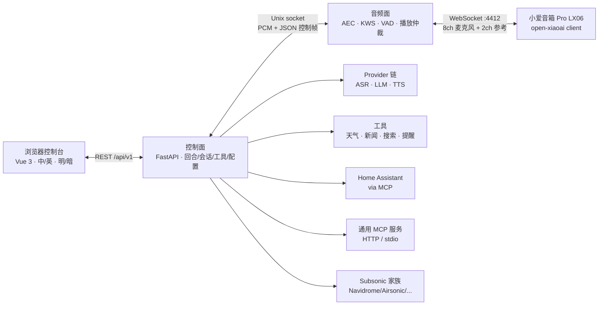
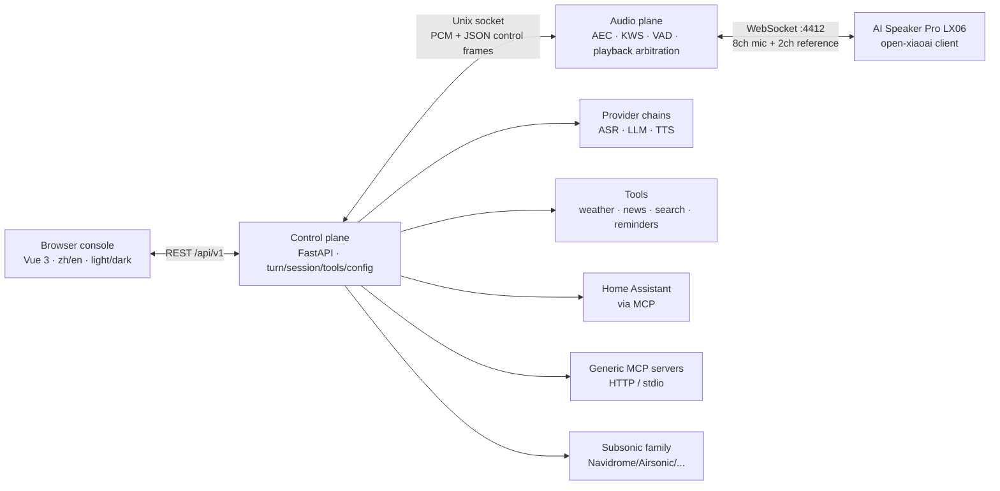

<div align="center">
  
  <h1>小瑞 · Rui</h1>
  <p><strong>把家里的音箱，变成只属于你的语音助手。</strong><br>
  <em>Turn the speaker you already own into a private voice assistant.</em></p>
  <p>
    <a href="https://github.com/yes999zc/rui/actions/workflows/ci.yml">
      
    </a>
    <a href="https://github.com/yes999zc/rui/actions/workflows/secret-scan.yml">
      
    </a>
    <a href="https://github.com/yes999zc/rui/actions/workflows/docker-publish.yml">
      
    </a>
    <a href="LICENSE">
      
    </a>
    <a href="https://github.com/yes999zc/rui/releases/latest">
      
    </a>
  </p>
  <p><a href="#中文">中文</a> · <a href="#english">English</a></p>
</div>

> **Name note:** the repository, container image, Python package, CLI, config paths and
> environment variables are all `rui`. Upgrading from 0.1.x is covered by the
> [migration guide](docs/migration-house-ear-to-rui.md).

---

## 中文

### 0.4.x 有什么新东西

> **0.4.1（2026-10-25）让第一次登录、音乐音源和外部设备接入都更顺。**
>
> - **首次登录不再丢 token**：安装脚本把控制台 token 存到 `~/rui/console-token.txt`
>   （0600，重跑不覆盖），401 弹窗直接给出 `rui token` 找回命令。
> - **Jellyfin / Emby 音源**：音乐页新增 MediaBrowser 家族预设（url + 只写 API key），
>   搜索/随机/收藏/播放走同一套 `MusicSource` 接口，测试连接用真实 `ping`。
> - **dot2 外部设备修复**：设备状态/连接页显示生效端口与环境名（8870 / `DOT2_EM_TOKEN`，
>   不再误显示 4412 / `RUI_DEVICE_TOKEN`），端口冲突不再误报；新增
>   `audio.voice.followup_delay_ms` / `followup_replay` 与 register 后设备唤醒重探测。
> - **文档重写**：README 与 [`docs/first-run.md`](docs/first-run.md) 按 0.4.x 现状重写。
>
> [v0.4.1 Release](https://github.com/yes999zc/rui/releases/tag/v0.4.1) ·
> [CHANGELOG](CHANGELOG.md) ·
> [对比 v0.4.0...v0.4.1](https://github.com/yes999zc/rui/compare/v0.4.0...v0.4.1)
>
> 0.4.0 的控制台 IA 重构（两分组、合并页、provider/音乐预设、凭据/系统页）见
> [v0.4.0 Release](https://github.com/yes999zc/rui/releases/tag/v0.4.0)。

### 这是什么

小瑞（Rui）是一个**自托管、本地优先**的家庭语音终端：一台你拥有的音箱通过 WebSocket
拨入家里的 NAS，唤醒、AEC、VAD、播放都在本地音频面完成，云端只做你显式配置的
ASR/LLM/TTS。

- **完整回合在本地编排**：唤醒 → 分段 → ASR → LLM（可调工具）→ 流式 TTS → 推回音箱；
  ASR 默认本地 SenseVoice，云端可兜底。
- **能力都在一个控制台里**：中英双语、明暗主题、两分组导航；供应商/音源预设、只写凭据、
  设备管理、安装向导、诊断与日志。
- **一条命令部署到 NAS**：Docker Compose + amd64/arm64 镜像；配置/数据/模型都在卷里，
  音频面崩溃由 watchdog 拉起。

### 界面

<p align="center">
  
</p>
<p align="center"><em>总览：真实信号、试一试、音频面遥测——不是占位数据。</em></p>

<table>
  <tr>
    <td width="50%"></td>
    <td width="50%"></td>
  </tr>
  <tr>
    <td><em>AI 供应商：三段链路、预设/自定义、就绪徽章与试听。</em></td>
    <td><em>首次运行向导：密钥、模型、设备准备/接线、测试、试一句。</em></td>
  </tr>
</table>

> 截图来自真实本地控制台，已隐去 LAN 地址和个人路径；当前为 0.4.x 截图，
> Phase 4 收尾后统一刷新。

### 30 秒快速开始

**前置**：一台 Linux NAS（amd64/arm64，4 核 / 4 GB 内存 / 2 GB 可用磁盘），Docker Engine + `docker compose`
插件；音箱已运行 [open-xiaoai](https://github.com/coderzc/open-xiaoai) client，并与 NAS 在同一 LAN/L2。

```bash
curl -4 -fsSL https://raw.githubusercontent.com/yes999zc/rui/main/deploy/install.sh | sh
```

安装脚本会拉取 compose/配置模板、生成控制台 token 与 device token、准备本地模型（首次约 239 MB），
最后等待 `/health`。首次通常 **4–8 分钟**；镜像已就绪、只需下载 ASR 时约 **85 秒**。

生产环境建议固定版本（脚本、compose 和镜像都锁到同一个 tag；当前发布为 **0.4.1**）：

```bash
curl -4 -fsSL https://raw.githubusercontent.com/yes999zc/rui/v0.4.1/deploy/install.sh \
  | RUI_REF=v0.4.1 RUI_IMAGE=ghcr.io/yes999zc/rui:0.4.1 sh
```

装到 `/vol1/rui` 时，在管道后加 `RUI_HOME=/vol1/rui`；目录权限、代理、源码回退和手动 Compose 见 [docs/deploy.md](docs/deploy.md)。

> 安装完成后打开 `http://<nas-lan-ip>:8080/`，输入 **console token**（0.4.1+ 会存到 `~/rui/console-token.txt`；
> 0.4.0 或文件缺失时运行 `cd ~/rui && docker compose exec -T rui rui token`）。**必须用 NAS 的局域网 IP**：
> 用 `localhost` 或 SSH 隧道打开会让 `connect` 生成 `ws://127.0.0.1:4412`，音箱永远连不上。

### 第一次运行

安装完成后，控制台会进入 `/setup`，8 步都在浏览器里完成，**不需要手改 YAML**：

| 步骤 | 做什么 | 完成标志 |
|---|---|---|
| `keys` | 为 LLM / ASR / TTS 各选一个 provider（可用预设新建/探测） | 每个用途都有可用 provider |
| `models` | 只检查 ASR / VAD / KWS 文件，不代下 | 三项都打勾 |
| `prepare` | 按清单确认 open-xiaoai client、IP、SSH/日志/回滚 | 设备侧清单确认 |
| `params` | 写入音箱 IP、房间、唤醒词、音量/LED/端口/增益 | 保存后无 `plane_error` |
| `wake` | 1–3 个唤醒词，重新生成 `keywords.txt` | 文件里有对应 `@词` 行 |
| `connect` | 复制 ws URL + device token 到 client 并重启 | 状态“已连接” |
| `test` | 只读探测音频面、主机/SSH、token | 音箱真的回连才算通过 |
| `verify` | 跑一次真实回合 | 听到回答，或手动确认 |

- 最少凭据是 **LLM + TTS** 两组；ASR 默认用本地 SenseVoice，不需要 key。
- 完整 8 步说明、参数来源、连接排障和安装后命令见 [**docs/first-run.md**](docs/first-run.md)：
  [8 步向导](docs/first-run.md#八步向导) · [参数来源](docs/first-run.md#音箱参数从哪来) ·
  [连接排障](docs/first-run.md#连接接线与排障) · [安装后命令](docs/first-run.md#安装后命令速查)。

### 功能

| 领域 | 你能得到什么 |
|---|---|
| 语音回合 | 唤醒 → 分段 → ASR → LLM + 工具 → 流式 TTS → 播放；本地音频面负责 AEC、KWS、VAD 和播放仲裁 |
| ASR | 本地 SenseVoice（默认，sherpa-onnx）、火山流式识别 2.0、OpenAI 兼容 ASR |
| LLM | 任意 OpenAI 兼容端点；11 个预设（OpenAI/DeepSeek/SiliconFlow/Moonshot/智谱/百炼/OpenRouter/Groq/Ollama/LM Studio/vLLM）+ 自定义 |
| TTS | 讯飞、火山豆包语音合成 2.0、OpenAI 兼容 TTS；控制台可按音色/语速/情感试听 |
| 控制台 | Vue 3 中英双语、明暗主题、两分组约 12 个入口；总览/对话/记忆/日志/体检 |
| 供应商 | 预设创建、保存前探测、就绪/缺配置徽章、主用/fallback 链；密钥只写不读 |
| 音乐 | Subsonic 家族 5 个预设（Navidrome/Airsonic/Gonic/Ampache/自定义）；搜索、随机、收藏、取流；真实连接测试 |
| 工具与集成 | 天气/新闻/联网搜索/提醒/记忆；Home Assistant 第一方 MCP（六工具白名单、危险域硬拒、`local.ha_*`）；通用 MCP（HTTP headers + 只写 `token_env`、stdio 闸） |
| 设备与插头 | Socket/Plug v1 manifest、能力协商、`device_wake`；LX06 参考插头；设备状态/启停/token 轮换/端口冲突 |
| 远程通道 | Telegram 与微信 iLink/ClawBot，独立 `rui-channels` 进程，文字/语音，不依赖音频面 |
| 运维与安全 | 一键安装、多架构镜像、非 root 容器、配置 last-good 恢复、备份/恢复、doctor/healthcheck、CVE 扫描、SSRF 出站守卫 |

### 架构



几条固定规则：

1. **只有音频面碰麦克风和音箱**；控制面不直接向设备写音频。
2. **播放只有一个 owner**：唤醒提示音 P0 → 回答 P1 → 提醒 P2 → 音乐 P3；
   高优先级可以暂停/打断低优先级。
3. **设备拨入，控制面不主动连设备**（除了设备 client 自己暴露的有限 shell 通道）。
4. 设备、DSP、provider、工具之间只通过接口通信；新增一款音箱只改一个
   adapter/plugin + manifest。

更深入的分层、进程模型和 IPC 契约见 [docs/architecture.md](docs/architecture.md)，音频链路细节见
[docs/audio-pipeline.md](docs/audio-pipeline.md)，插头契约见 [docs/socket-plug-v1.md](docs/socket-plug-v1.md)。

### 支持与状态

| 范围 | 状态 | 说明 |
|---|---|---|
| 当前发布 | **0.4.1**（2026-10-25） | 安装命令固定 0.4.1；Phase 4（0.4.2）在做 |
| CI / 质量 | 通过 | 1,141 passed / 18 skipped；ruff clean；web typecheck/build 绿；secret-scan 绿 |
| 镜像 | 多架构 | `ghcr.io/yes999zc/rui:0.4.1`，linux/amd64 + linux/arm64 |
| 宿主 | Linux NAS（amd64/arm64） | Docker Engine + compose 插件；生产目标；4 核/4 GB/2 GB 磁盘 |
| 音箱 | 小爱音箱 Pro（LX06） | 需预装 open-xiaoai client；同 LAN/L2；回连 `4412` |
| 外部设备 | Echo Dot 2（dot2） | 通过外部 `rui-dot2-bridge` + Socket/Plug v1 接入，**非本仓交付** |
| 音乐音源 | Subsonic 家族 + MediaBrowser 家族 | Navidrome/Airsonic/Gonic/Ampache/Jellyfin/Emby/custom；Plex 尚未实现 |

**v1 验收**（2026-10-24，真实 NAS + LX06）：冷装到第一句 **423 s**；80% 音量放歌 **19/20** 唤醒；
打断 max **205.2 ms**；公开仓/GHCR 可匿名拉取。数字来自开发/NAS 硬件，不是通用 benchmark。

### 已知限制

- **单设备**：0.4.x 一个 `:4412` 入口只接一个音箱 client；多设备仲裁、每设备配置 v3 仍在路线图上。
- **只支持 LX06**：需要 open-xiaoai client、同 LAN/L2；刷机/装 client 属于上游流程，
  Rui 不代刷、不托管固件。
- **音乐协议**：Subsonic 家族 + Jellyfin/Emby（MediaBrowser 家族）；Plex 需要新适配器，当前不提供假预设。
- **首次登录 token**：0.4.1+ 把 token 存到 `~/rui/console-token.txt`（0600，重跑不覆盖），401 弹窗给出恢复命令；0.4.0 或文件缺失时用 `rui token` 找回。
- **控制台收尾**：Phase 4（旧路由/文档/截图清理、单一 nav manifest）排在 0.4.2；旧路由仍以 redirect/alias 保留。
- **第三方插头隔离**：sidecar 隔离、签名/allowlist、多设备 owner 仲裁尚未交付；
  第三方 in-process 需要可信 manifest。
- **体验欠账**：手机对话卡片化、音乐收藏/口味 UI、远场唤醒正式计数、音量对账等仍在
  [docs/remaining-work.md](docs/remaining-work.md)。
- **生产微信**：Telegram 已生产验证；微信 iLink 接口保留，但生产机尚未完成验证。

### 文档索引

| 你想做什么 | 从这里开始 |
|---|---|
| 第一次安装与 8 步向导 | [docs/first-run.md](docs/first-run.md) |
| 部署、模型、升级/回滚 | [docs/deploy.md](docs/deploy.md) |
| 日常运维、备份/恢复 | [docs/runbook.md](docs/runbook.md) |
| 安全、SSRF、非 root 容器 | [docs/security.md](docs/security.md) · [docs/security-scanning.md](docs/security-scanning.md) |
| 架构、进程模型、IPC | [docs/architecture.md](docs/architecture.md) · [docs/audio-pipeline.md](docs/audio-pipeline.md) |
| 控制台信息架构 | [docs/console.md](docs/console.md) · [docs/console-ia-audit.md](docs/console-ia-audit.md) |
| 配置目录与字段 | [docs/config-catalog-contract.md](docs/config-catalog-contract.md) |
| 供应商预设/API | [docs/provider-presets.md](docs/provider-presets.md) |
| 音乐音源/凭据 | [docs/music-sources.md](docs/music-sources.md) · [docs/music.md](docs/music.md) |
| MCP / Home Assistant | [docs/integrations-mcp.md](docs/integrations-mcp.md) · [docs/mcp-generic.md](docs/mcp-generic.md) |
| 音箱接入（open-xiaoai） | [docs/open-xiaoai-client.md](docs/open-xiaoai-client.md) |
| Socket/Plug v1 与参考插头 | [docs/socket-plug-v1.md](docs/socket-plug-v1.md) · [plugins/rui-plugin-xiaoai](plugins/rui-plugin-xiaoai/README.md) |
| 发布记录 | [CHANGELOG.md](CHANGELOG.md) · [docs/releases/](docs/releases/) · [GitHub Releases](https://github.com/yes999zc/rui/releases) |
| 路线图与剩余工作 | [docs/ROADMAP.md](docs/ROADMAP.md) · [docs/remaining-work.md](docs/remaining-work.md) |
| 本地开发 | [docs/deploy.md](docs/deploy.md) |

### 安全与隐私

- **本地优先**：音频、KWS/VAD/AEC 和本地 ASR 都在你自己的机器上；只有你显式配置的
  LLM/TTS/搜索/音乐/HA/MCP 服务会收到相应请求。
- **密钥只写不读**：`.env` / `data/secrets.yaml`（0600）注入；provider 草稿密钥只在内存中用于探测；
  音乐凭据在 `lan_media.json`（0600）；所有 GET 只回 `has_key`/`has_value`。
- **控制台鉴权**：安装时生成随机 token；非 loopback 且无 token 时服务拒绝启动。
  不要把 `:8080` 直接暴露到公网；远程访问走 Tailscale/VPN 或带 TLS 的反向代理。
- **非 root 容器**：以 `rui`（uid/gid 1000）运行；`/app` 与根文件系统只读（`/tmp` 为 tmpfs），
  只有 `config/`、`data/` 可写；`cap_drop: ALL` + `no-new-privileges`。
- **SSRF 出站守卫**：HA、通用 MCP、音乐音源和搜索里由配置/远端数据决定的 URL 统一
  校验；云元数据、链路本地、组播、保留地址始终拒绝，默认允许内网、默认拒绝回环。
- **供应链**：CI 跑 `pip-audit` 与 Trivy；发布镜像来自固定 Dockerfile；secret-scan
  阻止凭据入库。
- 设备 token 等同音箱控制权；漏洞请勿公开开 issue，先通过 GitHub 私下联系维护者。

细节：[docs/security.md](docs/security.md) ·
[docs/security-scanning.md](docs/security-scanning.md)。

### 致谢

小瑞建立在这些开源项目与模型之上：

- [open-xiaoai](https://github.com/coderzc/open-xiaoai) — 音箱端 client 与 LX06 回连协议（MIT）
- [EchoMuse](https://github.com/wilbowes/EchoMuse) — 设备管理后台的参考实现（MIT，未直接随镜像分发）
- [sherpa-onnx](https://github.com/k2-fsa/sherpa-onnx) — 本地 ASR / 唤醒词运行时（Apache-2.0）
- [SenseVoice / FunAudioLLM](https://github.com/FunAudioLLM/SenseVoice) — 本地语音识别模型（权重遵循 FunASR Model License，非 MIT）
- [Silero VAD](https://github.com/snakers4/silero-vad) — 语音活动检测（MIT）
- [SpeexDSP](https://github.com/xiph/speexdsp) — 回声消除（BSD-3-Clause）
- [FFmpeg](https://ffmpeg.org/) — 音乐/语音转码（LGPL-2.1+；镜像内由固定版本源码构建，仅链接 libopus / libmp3lame）

MIT 只覆盖本仓库自己的代码；以上组件各自保留许可证，完整清单与核查状态见
[THIRD_PARTY.md](THIRD_PARTY.md)。

### License 与品牌

代码以 **MIT** 发布，见 [LICENSE](LICENSE)。`小瑞 / Rui` 名称与 logo 是项目品牌资产，
不随 MIT 授权用于其他产品品牌；截图仅用于本项目展示。

---

## English

### What's new in 0.4.x

> **0.4.1 (2026-10-25) smooths first login, music sources and external-device setup.**
>
> - **No more lost console token:** the installer saves it to `~/rui/console-token.txt`
>   (0600, reruns keep the file), and the 401 dialog shows the `rui token` recovery command.
> - **Jellyfin / Emby sources:** two MediaBrowser-family presets (url + write-only API key) behind the same
>   `MusicSource` interface; search/random/favorites/playback and a real `ping` test.
> - **dot2 external-device fixes:** status/connect now show the effective port and env name
>   (8870 / `DOT2_EM_TOKEN` instead of 4412 / `RUI_DEVICE_TOKEN`) and no longer report a false port conflict;
>   adds `audio.voice.followup_delay_ms` / `followup_replay` and register-time wake re-probing.
> - **Docs rewrite:** README and [`docs/first-run.md`](docs/first-run.md) rebuilt for the 0.4.x state.
>
> [v0.4.1 Release](https://github.com/yes999zc/rui/releases/tag/v0.4.1) ·
> [CHANGELOG](CHANGELOG.md) ·
> [Compare v0.4.0...v0.4.1](https://github.com/yes999zc/rui/compare/v0.4.0...v0.4.1)
>
> The 0.4.0 console IA refactor (two groups, merged pages, provider/music presets, credentials/system) is in
> [v0.4.0 Release](https://github.com/yes999zc/rui/releases/tag/v0.4.0).

### What it is

**Rui (小瑞)** is a self-hosted, local-first voice endpoint for a speaker you already own. A Xiaomi AI
Speaker Pro (LX06) running the **open-xiaoai client** dials into your NAS over WebSocket; wake word, VAD,
echo cancellation and playback live on the local audio plane; the cloud only sees the ASR/LLM/TTS providers
you configure.

- **The full turn is orchestrated locally:** wake → segment → ASR → LLM (with tools) → streaming
  TTS → PCM back to the speaker. ASR defaults to local SenseVoice; cloud ASR is optional.
- **One console for everything:** bilingual zh/en, light/dark, two navigation groups; provider/music
  presets, write-only credentials, device management, setup wizard, diagnostics and logs.
- **One command to a NAS:** Docker Compose + amd64/arm64 images; config, data and models live in volumes,
  and a watchdog restarts the audio plane if it crashes.

### Screenshots

<p align="center">
  
</p>
<p align="center"><em>Overview: live signals, the try-it composer and audio-plane telemetry — real data, not placeholders.</em></p>

<table>
  <tr>
    <td width="50%"></td>
    <td width="50%"></td>
  </tr>
  <tr>
    <td><em>AI providers: three-stage chain, presets/custom endpoints, readiness badges and audition.</em></td>
    <td><em>First-run wizard: keys, models, device preparation/hookup, test and a real sentence.</em></td>
  </tr>
</table>

> Captures come from a real local console with LAN addresses and personal paths redacted. They show
> the 0.4.x console; a Phase 4 refresh is planned.

### 30-second quick start

**Prerequisites:** a Linux NAS (amd64/arm64, 4 cores / 4 GB RAM / 2 GB free disk) with Docker Engine + the
`docker compose` plugin; the speaker already runs the [open-xiaoai](https://github.com/coderzc/open-xiaoai)
client on the same LAN/L2 as the NAS.

```bash
curl -4 -fsSL https://raw.githubusercontent.com/yes999zc/rui/main/deploy/install.sh | sh
```

The installer fetches the compose/config templates, generates the console and device tokens, prepares local
models (the first run downloads about 239 MB) and waits for `/health`. A first run usually takes **4–8 minutes**;
with the image already local and only ASR to fetch, about **85 seconds**.

For production, pin a release (script, compose files and image all come from the same tag; the
current release is **0.4.1**):

```bash
curl -4 -fsSL https://raw.githubusercontent.com/yes999zc/rui/v0.4.1/deploy/install.sh \
  | RUI_REF=v0.4.1 RUI_IMAGE=ghcr.io/yes999zc/rui:0.4.1 sh
```

To install under `/vol1/rui`, add `RUI_HOME=/vol1/rui` after the pipe. Directory ownership, proxies,
source fallback and manual Compose are covered in [docs/deploy.md](docs/deploy.md).

> After install, open `http://<nas-lan-ip>:8080/` and enter the **console token**; 0.4.1+ writes it to
> `~/rui/console-token.txt` (0600), while 0.4.0 or a missing file needs
> `cd ~/rui && docker compose exec -T rui rui token`. **Use the NAS LAN IP**: opening it through
> `localhost` or an SSH tunnel makes `connect` generate `ws://127.0.0.1:4412`, unreachable by the speaker.

### First run

After install the console opens `/setup`. All eight steps happen in the browser — **no YAML**:

| Step | What it does | Done looks like |
|---|---|---|
| `keys` | Pick one provider for LLM / ASR / TTS (create/probe from presets) | Every use has a usable provider |
| `models` | Check ASR / VAD / KWS files; never download | All three are green |
| `prepare` | Confirm open-xiaoai client, IP, SSH/logs/rollback checklist | Device-side items confirmed |
| `params` | Write speaker IP, room, wake words, volume/LED/port/gain | Saved with no `plane_error` |
| `wake` | 1–3 wake words; rewrite `keywords.txt` | An `@word` line exists for each word |
| `connect` | Copy the ws URL + device token into the client and restart it | Status “connected” |
| `test` | Read-only probe of the audio plane, host/SSH and token | Only a real speaker dial-in counts |
| `verify` | Run one real turn | You hear the answer, or confirm it manually |

- The minimum credentials are **LLM + TTS**; ASR defaults to local SenseVoice and needs no key.
- Full step tables, parameter sources, connection troubleshooting and post-install commands:
  [**docs/first-run.md**](docs/first-run.md) · [8-step wizard](docs/first-run.md#the-8-step-wizard) ·
  [parameter sources](docs/first-run.md#where-each-param-comes-from) ·
  [connect troubleshooting](docs/first-run.md#connect-troubleshooting) ·
  [after-install commands](docs/first-run.md#after-install-command-reference).

### Features

| Area | What you get |
|---|---|
| Voice turn | Wake → segment → ASR → LLM + tools → streaming TTS → playback; the local audio plane owns AEC, KWS, VAD and playback arbitration |
| ASR | Local SenseVoice (default, sherpa-onnx), Volc streaming ASR 2.0, OpenAI-compatible ASR |
| LLM | Any OpenAI-compatible endpoint; 11 presets (OpenAI/DeepSeek/SiliconFlow/Moonshot/Zhipu/DashScope/OpenRouter/Groq/Ollama/LM Studio/vLLM) + custom |
| TTS | XFYUN, Volc Doubao 2.0 and OpenAI-compatible TTS; audition by voice/rate/emotion in the console |
| Console | Vue 3 bilingual zh/en, light/dark, two groups and about 12 destinations; overview/turns/memory/logs/diagnostics |
| Providers | Create from presets, probe before saving, ready/missing badges, primary/fallback chains; keys are write-only |
| Music | 5 Subsonic-family presets (Navidrome/Airsonic/Gonic/Ampache/custom); search, random, favorites, streaming; real connection test |
| Tools & integrations | Weather/news/web search/reminders/memory; Home Assistant as a first-party MCP instance (six-tool whitelist, dangerous-domain refusal, `local.ha_*`); generic MCP (HTTP headers + write-only `token_env`, stdio gate) |
| Devices & plugs | Socket/Plug v1 manifests, capability negotiation, `device_wake`; the LX06 reference plug; device status/start-stop/token rotation/port conflicts |
| Remote channels | Telegram and WeChat iLink/ClawBot in a separate `rui-channels` process, text/voice, no audio plane required |
| Ops & security | One-command install, multi-arch images, non-root container, last-good config recovery, backup/restore, doctor/healthcheck, CVE scanning, SSRF egress guard |

### Architecture



Hard rules:

1. **Only the audio plane touches the microphone and speaker**; the control plane never writes audio.
2. **Playback has a single owner**: wake cue P0 → reply P1 → reminder P2 → music P3; higher priority may
   pause/interrupt lower.
3. **Devices dial in**; the control plane does not connect out (except through the device client's limited
   shell channel).
4. Devices, DSP, providers and tools talk through interfaces only; a new speaker means one adapter/plugin
   module plus its manifest.

Deeper layers, process model and IPC: [docs/architecture.md](docs/architecture.md) · audio chain:
[docs/audio-pipeline.md](docs/audio-pipeline.md) · plug contract:
[docs/socket-plug-v1.md](docs/socket-plug-v1.md).

### Support and status

| Scope | Status | Notes |
|---|---|---|
| Current release | **0.4.1** (2026-10-25) | Install commands pinned to 0.4.1; Phase 4 (0.4.2) in progress |
| CI / quality | Green | 1,141 passed / 18 skipped; ruff clean; web typecheck/build green; secret-scan green |
| Images | Multi-arch | `ghcr.io/yes999zc/rui:0.4.1`, linux/amd64 + linux/arm64 |
| Host | Linux NAS (amd64/arm64) | Docker Engine + compose plugin; production target; 4 cores/4 GB/2 GB disk |
| Speaker | Xiaomi AI Speaker Pro (LX06) | Needs the open-xiaoai client; same LAN/L2; dials back on `4412` |
| External device | Echo Dot 2 (dot2) | Via the external `rui-dot2-bridge` + Socket/Plug v1; **not shipped here** |
| Music sources | Subsonic + MediaBrowser families | Navidrome/Airsonic/Gonic/Ampache/Jellyfin/Emby/custom; Plex not implemented |

**v1 acceptance** (2026-10-24, real NAS + LX06): cold install to first sentence **423 s**; **19/20** wakes at
80% volume; barge max **205.2 ms**; public repo/GHCR anonymous pull works. Dev/NAS numbers, not a universal
benchmark.

### Known limitations

- **Single device:** one `:4412` entry accepts one speaker client in 0.4.x; multi-device arbitration/per-device
  config v3 remain on the roadmap.
- **LX06 only:** needs the open-xiaoai client and same LAN/L2; flashing and client installation are upstream,
  not done by Rui.
- **Music protocols:** Subsonic family plus Jellyfin/Emby (MediaBrowser family). Plex needs a new
  adapter; there are no fake presets for it.
- **First-login token:** 0.4.1+ saves it to `~/rui/console-token.txt` (0600, reruns keep the file) and
  the 401 dialog shows recovery commands; 0.4.0 or a missing file falls back to `rui token`.
- **Console cleanup:** Phase 4 (legacy routes/docs/screenshots, single nav manifest) is scheduled for 0.4.2;
  legacy routes still redirect.
- **Third-party plug isolation:** sidecar isolation, signing/allowlists and multi-device owner
  arbitration are not shipped; in-process third-party plugs require a trusted manifest.
- **UX debt:** mobile turn cards, music favorites/taste UI, formal far-field wake counting and volume
  reconciliation remain in [docs/remaining-work.md](docs/remaining-work.md).
- **WeChat in production:** Telegram is production-verified; the WeChat iLink interface is kept, but
  production validation is still pending.

### Documentation

| What you need | Start here |
|---|---|
| First install and the 8-step wizard | [docs/first-run.md](docs/first-run.md) |
| Deploy, models, upgrade/rollback | [docs/deploy.md](docs/deploy.md) |
| Day-2 ops, backup/restore | [docs/runbook.md](docs/runbook.md) |
| Security, SSRF, non-root container | [docs/security.md](docs/security.md) · [docs/security-scanning.md](docs/security-scanning.md) |
| Architecture, process model, IPC | [docs/architecture.md](docs/architecture.md) · [docs/audio-pipeline.md](docs/audio-pipeline.md) |
| Console information architecture | [docs/console.md](docs/console.md) · [docs/console-ia-audit.md](docs/console-ia-audit.md) |
| Config catalog and fields | [docs/config-catalog-contract.md](docs/config-catalog-contract.md) |
| Provider presets/API | [docs/provider-presets.md](docs/provider-presets.md) |
| Music sources/credentials | [docs/music-sources.md](docs/music-sources.md) · [docs/music.md](docs/music.md) |
| MCP / Home Assistant | [docs/integrations-mcp.md](docs/integrations-mcp.md) · [docs/mcp-generic.md](docs/mcp-generic.md) |
| Speaker hookup (open-xiaoai) | [docs/open-xiaoai-client.md](docs/open-xiaoai-client.md) |
| Socket/Plug v1 and reference plug | [docs/socket-plug-v1.md](docs/socket-plug-v1.md) · [plugins/rui-plugin-xiaoai](plugins/rui-plugin-xiaoai/README.md) |
| Release history | [CHANGELOG.md](CHANGELOG.md) · [docs/releases/](docs/releases/) · [GitHub Releases](https://github.com/yes999zc/rui/releases) |
| Roadmap and remaining work | [docs/ROADMAP.md](docs/ROADMAP.md) · [docs/remaining-work.md](docs/remaining-work.md) |
| Local development | [docs/deploy.md](docs/deploy.md) |

### Security and privacy

- **Local-first:** audio, KWS/VAD/AEC and local ASR stay on your machine; only the
  LLM/TTS/search/music/HA/MCP services you explicitly configure receive the relevant requests.
- **Write-only secrets:** injected via `.env` / `data/secrets.yaml` (0600); provider draft keys stay in memory
  for a probe; music credentials live in `lan_media.json` (0600); GETs return only `has_key`/`has_value`.
- **Console auth:** a random token is generated at install; the service refuses to start on a non-loopback
  bind without one. Do not expose `:8080` publicly; use Tailscale/VPN or a TLS reverse proxy.
- **Non-root container:** runs as `rui` (uid/gid 1000); `/app` and the root filesystem are read-only
  (`/tmp` is a tmpfs), only `config/` and `data/` persist writes; `cap_drop: ALL` +
  `no-new-privileges`.
- **SSRF egress guard:** URLs driven by config/remote data in HA, generic MCP, music sources and
  search are validated; cloud metadata, link-local, multicast and reserved addresses are always
  refused; private networks are allowed by default and loopback is refused by default.
- **Supply chain:** CI runs `pip-audit` and Trivy; release images come from a pinned Dockerfile;
  secret-scan blocks credentials from landing in the repo.
- The device token is equivalent to speaker control; report vulnerabilities privately through GitHub
  instead of opening a public issue.

Details: [docs/security.md](docs/security.md) · [docs/security-scanning.md](docs/security-scanning.md).

### Credits

Rui stands on these open-source projects and models:

- [open-xiaoai](https://github.com/coderzc/open-xiaoai) — speaker-side client and LX06 dial-in protocol (MIT)
- [EchoMuse](https://github.com/wilbowes/EchoMuse) — reference for the device-management console (MIT; no code shipped)
- [sherpa-onnx](https://github.com/k2-fsa/sherpa-onnx) — local ASR and wake-word runtime (Apache-2.0)
- [SenseVoice / FunAudioLLM](https://github.com/FunAudioLLM/SenseVoice) — local speech-recognition model (weights under the FunASR Model License, not MIT)
- [Silero VAD](https://github.com/snakers4/silero-vad) — voice-activity detection (MIT)
- [SpeexDSP](https://github.com/xiph/speexdsp) — echo cancellation (BSD-3-Clause)
- [FFmpeg](https://ffmpeg.org/) — music/voice transcoding (LGPL-2.1+; built in-image from a pinned source tarball, linking only libopus / libmp3lame)

MIT covers this repository's own code only. These components keep their own licenses; the full
inventory and verification status is in [THIRD_PARTY.md](THIRD_PARTY.md).

### License and brand

Code is released under **MIT**; see [LICENSE](LICENSE). The `小瑞 / Rui` name and logo are project
brand assets, separate from the MIT grant, and the screenshots are for this project only.
