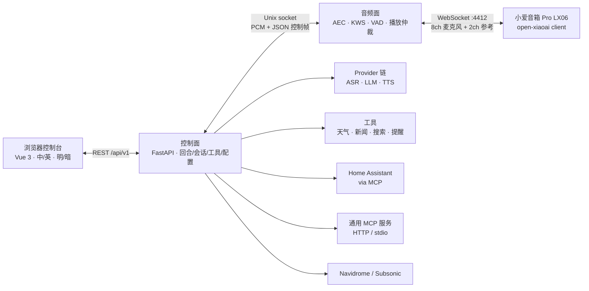
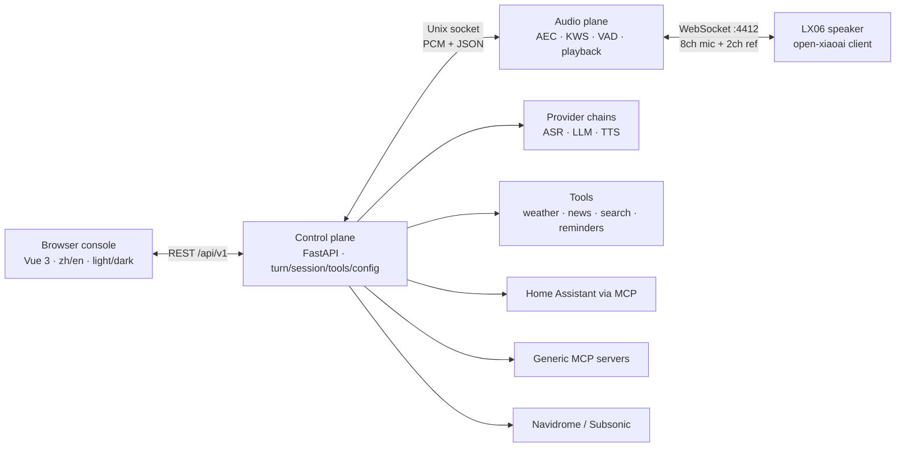

<div align="center">
  
  <h1>小瑞 · Rui</h1>
  <p><strong>把家里的音箱，变成只属于你的语音助手。</strong><br>
  <em>Turn the speaker you already own into a private voice assistant.</em></p>
  <p>
    <a href="https://github.com/yes999zc/rui/actions/workflows/ci.yml"></a>
    <a href="https://github.com/yes999zc/rui/actions/workflows/secret-scan.yml"></a>
    <a href="https://github.com/yes999zc/rui/actions/workflows/docker-publish.yml"></a>
    <a href="https://github.com/yes999zc/rui/blob/main/LICENSE"></a>
    
    
  </p>
  <p><a href="#中文">中文</a> · <a href="#english">English</a> · <a href="https://github.com/yes999zc/rui">GitHub</a></p>
</div>

> **项目名**：仓库、镜像、Python 包、CLI、配置路径和环境变量已统一为 `rui`；从 0.1.x 升级见 [迁移说明](docs/migration-house-ear-to-rui.md)。

---

## 中文

### 这是什么

小瑞（Rui）是一个**自托管、本地优先**的家庭语音终端。它不把麦克风音频交给云端语音助手，而是让一台你拥有的音箱通过 WebSocket 拨入家里的服务：

- **唤醒词、VAD、回声消除、播放都在本地音频面完成**；ASR 优先本地 SenseVoice，可选火山流式识别 2.0，云端只做兜底；
- **TTS 链可选讯飞与火山豆包 2.0**，控制台可按音色/语速/情感试听；**完整回合**：唤醒 → 分段 → ASR → LLM（可调工具）→ 流式 TTS → 推回音箱；
- **能力**：Home Assistant（经 MCP）、通用 MCP 服务、天气/新闻/联网搜索、提醒、记忆、Navidrome/Subsonic 音乐；
- **控制台 2.0**：中英双语、明暗主题、四层配置目录、AI 供应商链路与音色试听、安装向导、诊断/日志；
- **一条命令部署到 NAS**：Docker Compose + 多架构镜像，数据/配置/模型都在卷里；音频面崩溃由 watchdog 拉起。

v1 目前只支持 **Xiaomi 小爱音箱 Pro（LX06）**，且音箱需要运行 **open-xiaoai client** 来拨入本服务。一键安装只部署 NAS 服务，不会修改音箱。

### 界面

<p align="center">
  
</p>
<p align="center"><em>总览：真实信号、试一试、音频面遥测——不是占位数据。</em></p>

<table>
  <tr>
    <td width="50%"></td>
    <td width="50%"></td>
  </tr>
  <tr>
    <td><em>AI 供应商：三段链路、供应商卡片、音色选择与音箱/本机试听。</em></td>
    <td><em>首次运行向导：密钥、模型、设备准备/接线、测试、试一句。</em></td>
  </tr>
</table>

> 截图来自本地开发实例，已隐去 LAN 地址和个人路径；没有公开任何密钥或 token。

### 架构



几条固定规则：

1. **只有音频面碰麦克风和音箱**；控制面不直接向设备写音频。
2. **播放只有一个 owner**：唤醒提示音 P0 → 回答 P1 → 提醒 P2 → 音乐 P3；高优先级可以暂停/打断低优先级。
3. **设备拨入，控制面不主动连设备**（除了设备 client 自己暴露的有限 shell 通道）。
4. 设备、DSP、provider、工具之间只通过接口通信；新增一款音箱理论上只改一个 adapter 模块 + 一行注册。

更深入的分层、进程模型和 IPC 契约见 [docs/architecture.md](docs/architecture.md)，音频链路细节见 [docs/audio-pipeline.md](docs/audio-pipeline.md)。

### 快速开始

#### 前置条件

| 需要 | 说明 |
|---|---|
| 一台 Docker 主机 | NAS / Linux，x86_64 或 arm64，建议 4 核 / 4 GB / 2 GB 可用磁盘 |
| Docker 权限 | 安装用户需为 root，或已加入 `docker` 组并重新登录（`docker info` 必须能通） |
| 可写安装目录 | 默认 `~/rui`；`/vol1` 这类 root-only 挂载点需用 root 安装或先 `chown` 给安装用户 |
| 小爱音箱 Pro（LX06） | 已刷/已装 **open-xiaoai client**，与主机在同一 LAN |
| LLM 与 TTS 密钥 | 每种用途（LLM/ASR/TTS）在向导里选一个 provider；LLM/TTS 需要密钥，ASR 可先用本地模型 |
| 可选 | Home Assistant、Navidrome、火山/讯飞语音账号 |

#### 一条命令（推荐）

滚动版本（`main` + `:latest`，先试最省事）：

```bash
curl -4 -fsSL https://raw.githubusercontent.com/yes999zc/rui/main/deploy/install.sh | sh
# 网络不通/卡住时用镜像：
#   RUI_RAW=https://ghproxy.net/https://raw.githubusercontent.com/yes999zc/rui/main \
#     curl -4 -fsSL "$RUI_RAW/deploy/install.sh" | sh
```

生产建议固定发布版本（脚本、compose 文件和镜像都锁到同一个 tag）：

```bash
curl -4 -fsSL https://raw.githubusercontent.com/yes999zc/rui/v0.2.1/deploy/install.sh \
  | RUI_REF=v0.2.1 RUI_IMAGE=ghcr.io/yes999zc/rui:0.2.1 sh
```

`RUI_REF` 决定拉取的 `docker-compose.yml` / `config.example.yaml` 来自哪个 ref，`RUI_IMAGE`
决定运行哪个镜像；只固定一个，重装或回滚时仍可能换版本。

安装脚本做五件事：

| 步骤 | 内容 |
|---|---|
| 1 | 拉取 `docker-compose.yml` 和 `config.example.yaml` 到 `~/rui/` |
| 2 | `rui setup` 写入生产配置模板，并生成默认唤醒词文件 `keywords.txt` |
| 3 | 生成 `.env`（含随机设备 token，0600） |
| 4 | 下载本地模型：SenseVoice ASR（约 239 MB，一次）；VAD/KWS 已内置镜像，直接复制 |
| 5 | `docker compose up -d`，等待 health 通过（不通过则以非 0 退出） |

同一 `~/rui` 可以安全重跑：如果 `rui` 容器属于本目录的 compose project，脚本直接
`docker compose up -d`（按需重建/补齐缺失模型）；容器属于其他目录/项目、或遇到 0.1.x 的
`house-ear` 容器时会报错并给出处理命令，不会擅自停删容器。

镜像：默认 `ghcr.io/yes999zc/rui:latest`（公开，多架构 amd64/arm64，滚动更新；生产用上面的固定 tag 示例）。如果镜像拉取失败，脚本会按 `RUI_REF` 从 `RUI_REPO` 的公开源码克隆并构建同一 tag（日志会打印 ref 和 commit）；也可以手动：

```bash
git clone https://github.com/yes999zc/rui.git
cd rui
docker build -t ghcr.io/yes999zc/rui:latest .
```

安装完成后：

```bash
cd ~/rui
# 控制台访问令牌（安装时生成；也可以稍后读取）
docker compose exec rui rui token
```

打开 `http://<nas-lan-ip>:8080/`，输入控制台 token，按**首次运行向导**的 8 步完成：
`keys`（每种用途选一个 provider、填密钥）→ `models`（检查 ASR/VAD/KWS）→
`prepare`（按说明装 open-xiaoai client）→ `params`（音箱地址/房间）→ `wake`（唤醒词）→
`connect`（复制 ws 地址 + device token）→ `test`（等音箱回连）→ `verify`（试一句）。
正常路径不需要手改 YAML。

#### 音箱端（必须单独做）

音箱必须运行 open-xiaoai client 并回连：

```text
ws://<nas-lan-ip>:4412/?token=<RUI_DEVICE_TOKEN>
```

设备 token 在 `~/rui/.env` 的 `RUI_DEVICE_TOKEN`；服务端和 client 必须一致。详细接线、音量/LED 能力、协议说明见 [docs/deploy.md](docs/deploy.md) 和 [docs/xiaoai-protocol.md](docs/xiaoai-protocol.md)。

#### 手动 Docker Compose

```bash
mkdir -p ~/rui && cd ~/rui
curl -fsSL https://raw.githubusercontent.com/yes999zc/rui/main/docker-compose.yml -O
curl -fsSL https://raw.githubusercontent.com/yes999zc/rui/main/config.example.yaml -O
# 按 docs/deploy.md 填 .env，再：
docker compose up -d
```

### 配置速览

配置目录由服务端声明，控制台按目录渲染，不需要为每个参数改前端。重点区域：

| 区域 | 关键项 | 说明 |
|---|---|---|
| AI 供应商 | `providers.catalog` + `providers.{asr,tts,llm}.chain` | 向导每个 use 选一个 provider 并写成 `chain=[selected]`；有序 fallback、音色/语速/情感仍可在控制台改并试听 |
| 音箱 | `devices[]` | adapter、回连端口、房间、唤醒词、音量、LED；v1 仅 LX06 |
| 音频 | `audio.capture / voice / playback / aec` | 采样率、帧长、VAD、AEC、播放缓冲；改完重启音频面 |
| 会话 | `session.*` | 空闲超时、结束词、上下文开关、filler 策略 |
| 音乐 | `music.*` | `navidrome` 源、凭据写入、缓存；凭据只写不读 |
| 工具 | `tools.*` | 搜索、天气、新闻、Home Assistant、MCP servers、工具暴露策略 |
| 控制台 | `web.*` | 端口、鉴权 token、日志级别 |

- 完整字段/效果/重启规则：[docs/config-catalog-contract.md](docs/config-catalog-contract.md)
- 部署、密钥、音乐/HA 配置：[docs/deploy.md](docs/deploy.md)
- 音乐层：[docs/music.md](docs/music.md)；通用 MCP：[docs/mcp-generic.md](docs/mcp-generic.md)
- 模型自建镜像（可选）：`.env` 设 `RUI_ASR_URL` / `RUI_VAD_URL` /
  `RUI_KWS_URL`（完整文件 URL，失败回退内置镜像）；VAD/KWS 默认从镜像 seed 复制，
  不再访问 GitHub release。详见 [docs/deploy.md §3.3](docs/deploy.md#33-模型fetch-models-一次装齐)
- 日常运维（起停、日志、升级、回滚）：[docs/runbook.md](docs/runbook.md)

### 远程通道（Telegram / 微信）

小瑞可以额外通过 Telegram 或微信 iLink/ClawBot 接收文字和语音，不需要音箱在线：

- 独立进程 `rui-channels`，复用控制面的 LLM/工具/会话，不依赖音频面；
- Telegram：长轮询、allowlist、语音输入、语音回复；
- 微信 iLink：扫码登录、`context_token`、`.silk` 重转写、音频文件回复；
- 控制台 **通道 / Channels** 页：启用、allowlist、回复模式、绑定/启动指令。

详见 [docs/channel-gateway.md](docs/channel-gateway.md)。

### 状态与已知缺口

**状态：v1 开发中。** 已跑通：完整语音回合、本地 ASR、音乐、HA/MCP、记忆、控制台、品牌/双语文案、Docker 多架构镜像与一键安装（含源码回退）。

部分实测（开发/本机硬件，不是通用 benchmark）：

| 项目 | 结果 | 来源 |
|---|---|---|
| 音频面（mock 48 kHz/8ch，5 分钟） | 14,234 帧，0 丢帧，rtf 0.0055 | `scripts/measure_plane.py` |
| AEC（6ch，doctor） | rtf ≈ 0.004（约单核 0.4%） | `rui doctor` |
| 本地 ASR（SenseVoice int8，短句） | 开发机 51–90 ms；NAS N100 约 210 ms | [docs/audio-latency.md](docs/audio-latency.md) |
| 完整回合（讯飞 TTS + deepseek-flash） | 20/20 回复，首响 p50 约 3.6 s | 同上 |

**还没闭环的**（完整列表和顺序见 [docs/remaining-work.md](docs/remaining-work.md)）：

- v1 验收项：80% 音量放歌 20 次唤醒 ≥19、打断 ≤300 ms 口径、完整发布检查；
- 真机遗留：远场唤醒计数、音量对账、音乐收藏/口味 UI、第二台设备（config v3）；
- 体验：手机对话卡片化、Providers 阶段标题/手机控件等细节；
- 0.2.0 改名：包名、CLI、路径与环境变量统一为 `rui`，旧变量名仍可回退（见[迁移说明](docs/migration-house-ear-to-rui.md)）。

> README 不承诺未实现的功能；以 `docs/remaining-work.md` 和实际控制台为准。

### 开发

```bash
# Python 控制面 / 音频面
uv sync --extra dev
uv run pytest
uv run ruff check src tests

# 本地开发服务（默认 :8080；开发脚本也可能用 :8091）
uv run rui serve

# 控制台
cd web
npm install
npm run typecheck
npm run build
```

- 部署与生产运维：[docs/deploy.md](docs/deploy.md) · [docs/runbook.md](docs/runbook.md)
- 设计/控制台契约：[docs/console.md](docs/console.md) · [docs/brand.md](docs/brand.md)
- 音频时延与调参：[docs/audio-latency.md](docs/audio-latency.md) · [docs/audio-pipeline.md](docs/audio-pipeline.md)

### 安全与隐私

- **本地优先**：音频、KWS/VAD/AEC 和本地 ASR 都在你自己的机器上；只有你配置的 LLM/TTS/搜索/音乐/HA 服务会收到相应请求。
- **密钥只写不读**：`.env` 或 `secrets.yaml`（0600）注入；控制台只显示 `has_key`，所有接口都不回显值。
- **控制台鉴权**：安装时生成随机 token；非 loopback 且无 token 时服务拒绝启动。不要把 `:8080` 直接暴露到公网；远程访问请走 Tailscale/VPN 或带 TLS 的反向代理。
- 设备 token 决定音箱回连权限，和音箱管理员权限等同，按家庭网络边界保护。
- 漏洞/安全问题请不要公开开 issue，先通过 GitHub 私下联系维护者。

### 致谢 / Credits

小瑞建立在这些开源项目与模型之上：

- [open-xiaoai](https://github.com/coderzc/open-xiaoai) — 音箱端 client 与 LX06 回连协议（MIT）
- [EchoMuse](https://github.com/wilbowes/EchoMuse) — 设备管理后台的参考实现（MIT，未直接随镜像分发）
- [sherpa-onnx](https://github.com/k2-fsa/sherpa-onnx) — 本地 ASR / 唤醒词运行时（Apache-2.0）
- [SenseVoice / FunAudioLLM](https://github.com/FunAudioLLM/SenseVoice) — 本地语音识别模型（模型权重遵循 FunASR Model License，非 MIT）
- [Silero VAD](https://github.com/snakers4/silero-vad) — 语音活动检测（MIT）
- [SpeexDSP](https://github.com/xiph/speexdsp) — 回声消除（BSD-3-Clause）
- [FFmpeg](https://ffmpeg.org/) — 音乐/语音转码（LGPL-2.1+；镜像内由固定版本源码构建，仅链接 libopus / libmp3lame）

MIT 只覆盖本仓库自己的代码；以上第三方组件各自保留其许可证，完整清单与核查状态见 [THIRD_PARTY.md](THIRD_PARTY.md)。

### License 与品牌

代码目前以 **MIT** 发布，见 [LICENSE](LICENSE)；许可证变更不在本轮范围，需要单独讨论。`小瑞 / Rui` 名称与 logo 是项目品牌资产，不随 MIT 授权用于其他产品品牌；截图仅用于本项目展示。

---

## English

> **Name note:** the repo, image, Python package, CLI, config paths and environment
> variables are all `rui`. Upgrading from 0.1.x is covered by the
> [migration guide](docs/migration-house-ear-to-rui.md).

### What it is

**Rui (小瑞)** is a self-hosted, local-first voice endpoint for a speaker you already own. A Xiaomi 小爱音箱 Pro (LX06) running the **open-xiaoai client** dials into your home server over WebSocket; the local audio plane handles wake word, VAD, echo cancellation and playback, and the control plane runs the full turn:

> wake → segment → local ASR (cloud fallback) → LLM + tools → streaming TTS → PCM back to the speaker.

ASR prefers local SenseVoice, with Volc streaming ASR 2.0 and a cloud fallback as optional chain entries; TTS can use Xfyun and Volc Doubao 2.0, with voice/rate/emotion audition in the console. It also ships a bilingual admin console (four-tier config catalog, provider-chain UX, setup wizard, diagnostics), Home Assistant over MCP, generic MCP servers, weather/news/web search, reminders, memory, and Navidrome/Subsonic music.

### Quick start

Requirements: a Docker host (NAS/Linux, amd64 or arm64), an LX06 with the **open-xiaoai client**, and one provider per use in the wizard. The LLM and TTS providers need keys; the local SenseVoice ASR does not need a cloud key. The install user must be able to reach the Docker daemon (root or the `docker` group, verified by `docker info`) and write the install directory (`~/rui` by default; root-only mounts such as `/vol1` need root or a prior `chown`).

Rolling release (`main` + `:latest`):

```bash
curl -4 -fsSL https://raw.githubusercontent.com/yes999zc/rui/main/deploy/install.sh | sh
```

For production, pin a release (script, compose files and image all come from the same tag):

```bash
curl -4 -fsSL https://raw.githubusercontent.com/yes999zc/rui/v0.2.1/deploy/install.sh \
  | RUI_REF=v0.2.1 RUI_IMAGE=ghcr.io/yes999zc/rui:0.2.1 sh
```

`RUI_REF` selects the ref for `docker-compose.yml` / `config.example.yaml`; `RUI_IMAGE` selects the image. Pinning only one can still change versions on a reinstall or rollback.

The installer writes `~/rui/`, generates a `.env` with a random device token, downloads the SenseVoice ASR model (~239 MB, one time; VAD/KWS are baked into the image and copied from `/opt/seed-models`), starts `docker compose`, and waits for health (a failed probe exits non-zero). Re-running it against the same `~/rui` reconciles that directory's `rui` container with `docker compose up -d`; a container owned by another directory, or a legacy `house-ear` container, fails with the exact stop command instead of being removed. For a self-hosted model mirror set `RUI_ASR_URL`, `RUI_VAD_URL` and `RUI_KWS_URL` in `.env` (full file URLs; built-in mirrors stay as fallbacks). Public image: **`ghcr.io/yes999zc/rui:latest`** (multi-arch, rolling; pin a tag as shown above for production). If the registry is unreachable, the installer builds the same tag from `RUI_REPO` at `RUI_REF` and logs the ref/commit; manual build:

```bash
git clone https://github.com/yes999zc/rui.git
cd rui && docker build -t ghcr.io/yes999zc/rui:latest .
```

Open `http://<nas-lan-ip>:8080/`, enter the console token printed at install time, and complete the 8-step first-run wizard: `keys` (one provider per use, credentials) → `models` → `prepare` (install the open-xiaoai client) → `params` (speaker address/room) → `wake` (wake words) → `connect` (ws URL + device token) → `test` (speaker dials in) → `verify` (one real sentence). No YAML editing is needed on the normal path. The speaker itself is configured separately:

```text
ws://<nas-lan-ip>:4412/?token=<RUI_DEVICE_TOKEN>
```

See [docs/deploy.md](docs/deploy.md) for volumes, keys, music/HA configuration and the speaker client, [docs/open-xiaoai-client.md](docs/open-xiaoai-client.md) for the step-by-step client hookup, and [docs/xiaoai-protocol.md](docs/xiaoai-protocol.md) for the LX06 wire protocol.

### Architecture



Hard rules: only the audio plane touches mic/speaker; playback has a single owner (cue P0 → reply P1 → reminder P2 → music P3); devices dial in, the control plane does not dial out. Deeper details: [docs/architecture.md](docs/architecture.md) · [docs/audio-pipeline.md](docs/audio-pipeline.md).

### Configuration

Provider order and fields live in `config.yaml`: `providers.catalog` plus one ordered chain per stage (`providers.asr/tts/llm.chain`). The setup wizard selects one provider per use and stores it as that stage's chain (`[selected]`), so an unconfigured fallback never blocks first-run completion. Speakers are `devices[]`; the audio plane is `audio.*`; session, music, tools and console/security settings are grouped in the console's four-tier catalog. Everything is editable in the console (422 validation maps back onto fields), or via the CLI/config file. See [docs/config-catalog-contract.md](docs/config-catalog-contract.md) and [docs/deploy.md](docs/deploy.md).

### Status and known gaps

**v1 is in progress — feature freeze is active (2026-10-24).** Working: full turn, local ASR, music, HA/MCP, memory, console 2.0, brand/i18n, multi-arch image, one-command install (with source fallback), Telegram channel, config recovery, and speaker onboarding. The remaining release gates are the real-device acceptance numbers (cold install, 19/20 wake at 80% volume, interrupt ≤300 ms); see [docs/ROADMAP.md](docs/ROADMAP.md) and [docs/acceptance.md](docs/acceptance.md). This README does not claim features that are not implemented.

### Development

```bash
uv sync --extra dev
uv run pytest
uv run ruff check src tests
uv run rui serve          # :8080

cd web
npm install
npm run typecheck
npm run build
```

Deploy/ops: [docs/deploy.md](docs/deploy.md) · [docs/runbook.md](docs/runbook.md). Audio latency notes: [docs/audio-latency.md](docs/audio-latency.md). Console contract: [docs/console.md](docs/console.md).

### Security and privacy

Audio and local recognition stay on your box; only the providers you configure receive the corresponding requests. Keys are injected via `.env` / `secrets.yaml` (0600) and are write-only through the API. The console uses a generated token and refuses to start on a non-loopback bind without one. Keep `:8080` on a trusted network (or put it behind TLS/VPN); the device token is equivalent to speaker control. See [docs/runbook.md](docs/runbook.md).

### 配置恢复

成功启动会把当前配置存为 `config.last-good.yaml`。如果下次启动时 `config.yaml` 校验失败，服务会保留坏文件、回退到 last-good（没有则用 schema 默认值），并在控制台顶部显示恢复 banner，可一键恢复；也可以：

```bash
rui config restore --last-good
rui config restore --defaults
```

详见 [docs/config-recovery.md](docs/config-recovery.md)。

### Support

如果小瑞帮到了你，可以请我喝杯咖啡：

<!-- TODO: replace the placeholder with the real Buy Me a Coffee page when ready. -->
<a href="https://www.buymeacoffee.com/" target="_blank" rel="noopener">
  
</a>

If Rui is useful to you, you can buy me a coffee — the link is a placeholder for now.

### Credits / 致谢

Rui stands on these open-source projects and models:

- [open-xiaoai](https://github.com/coderzc/open-xiaoai) — speaker-side client and LX06 dial-in protocol (MIT)
- [EchoMuse](https://github.com/wilbowes/EchoMuse) — reference for the device-management console (MIT; no code shipped)
- [sherpa-onnx](https://github.com/k2-fsa/sherpa-onnx) — local ASR and wake-word runtime (Apache-2.0)
- [SenseVoice / FunAudioLLM](https://github.com/FunAudioLLM/SenseVoice) — local speech-recognition model (weights under the FunASR Model License, not MIT)
- [Silero VAD](https://github.com/snakers4/silero-vad) — voice-activity detection (MIT)
- [SpeexDSP](https://github.com/xiph/speexdsp) — echo cancellation (BSD-3-Clause)
- [FFmpeg](https://ffmpeg.org/) — music/voice transcoding (LGPL-2.1+; built in-image from a pinned source tarball, linking only libopus / libmp3lame)

MIT covers this repository's own code only. These components keep their own licenses; the full inventory and verification status is in [THIRD_PARTY.md](THIRD_PARTY.md).

### License and brand

Code is currently **MIT**; see [LICENSE](LICENSE). A license change is out of scope for this round and needs a separate discussion. The 小瑞 / Rui name and logo are project brand assets, separate from the code license.
