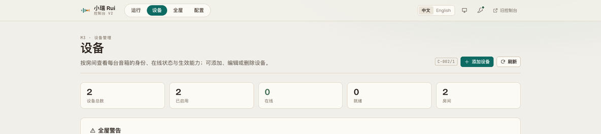
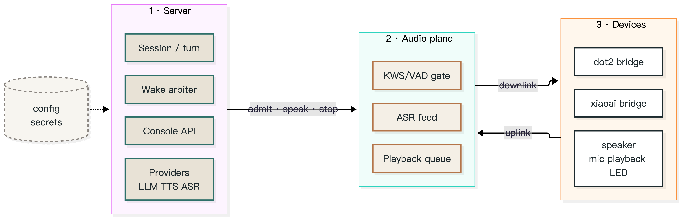

<div align="center">

# 小瑞 · rui

**把家里的音箱变成只属于你的语音助手。**
*Turn the speakers you already own into a voice assistant that answers to you.*

[](https://github.com/yes999zc/rui/actions/workflows/ci.yml)
[](https://github.com/yes999zc/rui/actions/workflows/secret-scan.yml)
[](https://github.com/yes999zc/rui/actions/workflows/docker-publish.yml)
[](LICENSE)
[](https://github.com/yes999zc/rui/releases)

</div>



---

# 中文

## 15 秒了解

家里已有的音箱继续用它们自己的麦克风和喇叭，但唤醒词、对话、记忆、音乐都走你自己的服务：一台机器上的 `rui` 服务 + 每种音箱一个桥接插件。控制台 `/v2` 可以加设备、改配置、看日志和轨迹，不用再手改 YAML。

```text
说「你好小瑞」→ 它答「在呢」→ 说「放首歌」→ 播放中再说「下一首」→ 说「退下吧」→ 结束这一轮
```

## 架构



架构图源文件：[`docs/assets/architecture.mmd`](docs/assets/architecture.mmd)；导出物 [`architecture.svg`](docs/assets/architecture.svg) / [`architecture.png`](docs/assets/architecture.png)（Mermaid；改配色后重新导出即可）。

| 层 | 职责 | 关键点 |
|---|---|---|
| **服务端（控制面）** | 会话与回合、工具调用、LLM/TTS/ASR 供应商、唤醒仲裁、v2 控制台 API、配置与密钥 | 一轮对话只由一台设备承担；播放态与回合按**房间**隔离，一屋放歌不会让另一屋变聋 |
| **音频平面** | 每台设备一个独立进程：拾音、KWS/VAD 门限、预录缓冲、回声切除、送 ASR、播放队列 | 门限在本地做，服务端只做决策；播放与唤醒的自回声有专门的剔除路径 |
| **设备（插件）** | 每种音箱一个 `rui-device/v1` 桥接插件：设备长连接、上下行音频、指示灯与按键 | 核心不含设备实现（旧拼写 `adapter: xiaoai` 只在**读入时**迁移为 `lx06` 并告警，该迁移 0.8.0 删除）；加一种音箱 = 加一个插件仓库 |

## 三个仓库是什么关系

| 仓库 | 角色 | 版本与发布 |
|---|---|---|
| **rui**（本仓） | 服务端 + 控制台：会话/回合、供应商、唤醒仲裁、音频门限、`/v2` 控制台 | 独立发布 |
| **[rui-dot2-bridge](https://github.com/yes999zc/rui-dot2-bridge)** | Dot2（RS03QR）的 `rui-device/v1` 插件 | 独立版本、独立发布 |
| **[rui-xiaoai-bridge](https://github.com/yes999zc/rui-xiaoai-bridge)** | LX06 的 `rui-device/v1` 插件 | 独立版本、独立发布 |

约束有两条，缺一不可：设备清单里的 `compatibility.rui_min`（这台设备至少要哪个 rui）与插件清单里的 `rui_compat`（这个插件支持哪一段 rui）。两者不满足时，加载器会**拒绝**这个插件，而不是带着半截功能跑。

| rui 核心 | rui-dot2-bridge | rui-xiaoai-bridge |
|---|---|---|
| **0.7.9**（当前，patch）：意图层两处行为变更 + 唤醒应答提前，**真机未验**（见 [release notes](https://github.com/yes999zc/rui/releases/tag/v0.7.9)） | **1.3.1**：`rui_compat >=0.6.0 <0.8.0`、设备清单 `compatibility.rui_min=0.3.0`（**本版无需重发**） | **0.2.2**：`rui_compat >=0.6.0 <0.8.0`、设备清单 `compatibility.rui_min=0.6.0`（**本版无需重发**） |
| 0.7.8（历史）：控制台默认 v2、TLS 安装、插件外置 | 1.3.1 | 0.2.2 |
| 0.8.0（计划）：删 `/legacy`、删 `adapter: xiaoai` 迁移、契约窗口调整；桥**须先发双窗口**（`>=0.7.0 <0.9.0`），见 [`docs/backlog-0.8.md`](docs/backlog-0.8.md) §a | 待定 | 待定 |
| 0.7.4（历史） | 1.3.1 | 0.2.2 |

> LX06 的插件**必须外置**：把 `rui-xiaoai-bridge` 挂到 `/opt/rui-plugins`，并设 `RUI_ADAPTER_PLUGINS` + `PYTHONPATH=/opt/rui-plugins`；挂上后日志为 `adapter plugins: registered dot2, lx06`。旧配置里的 `adapter: xiaoai` 在**读入时即迁移为 `lx06` 并打 WARNING**（`/health.adapter_plugins.warnings`），核心不再有兼容别名、也不回退内置实现；不挂插件时设备错误会明确提示去 mount 桥。该迁移在 **0.8.0 删除**。

## 让 AI 帮你装

把下面这段直接贴给任意 AI 助手（Claude / ChatGPT / DeepSeek 都行）：

```text
目标：用 Docker 跑起 rui 0.7.9，接一台 Dot2 和一台 LX06。
前置：docker compose version 通过；8080 空闲；5 GB 磁盘。
1) git clone --branch main https://github.com/yes999zc/rui.git && cd rui/examples/two-speakers   # main 才有本示例；镜像仍 pin 在 0.7.9
2) git clone --branch v1.3.1 https://github.com/yes999zc/rui-dot2-bridge.git && git clone --branch v0.2.2 https://github.com/yes999zc/rui-xiaoai-bridge.git
3) mkdir -p plugins && cp -r rui-dot2-bridge/src/rui_dot2_bridge rui-xiaoai-bridge/src/rui_xiaoai_bridge plugins/
4) 写 ./config/config.yaml：web.auth_token、devices[]（id/adapter/room/host/listen_port；lx06 的 host 必填）
5) TLS（dot2 的 tls_port 开启时必需）：把原 controller 证书放到 ./secrets/（server.pem + server.key）；没有就运行 `bash ../../scripts/make_dev_tls.sh` 自签。自签只保证音频平面能起，真机是否接受取决于设备信任的 CA（详见 `docs/audit/tls-required-2026-10.md`）。**默认只起第一台设备的平面；两台都起需在 config 设 `multi_device: {enabled: true, max_planes: 2}`**
6) export RUI_DEVICE_TOKEN=<设备令牌>; docker compose up -d
7) 验收：/health 里 devices=2、device_errors=0、adapter_plugins.registered=["dot2","lx06"]；audio_plane=false 时看日志的 RUI_DEVICE_TOKEN / missing TLS material
失败看：docker compose logs --tail=80 rui 的 config error / adapter / TLS；回滚：down 后把 image 换回上一版 tag；TLS 失败可先移走 ./secrets/ 确认是否 TLS 引起
不需要自己编译 ffmpeg（镜像已内置）
```

## 特性

- **多设备、按房间隔离**：设备按房间分组，唤醒与播放的互斥只在本房间生效，跨房间的播放与回合仲裁互不影响。
- **播放中打断（barge-in）**：播放时唤醒立即停播并进入对话，服务端停播延迟以毫秒计。
- **自回声抑制**：唤醒提示音（「在呢」）实测 0/10 泄漏；普通唤醒撞上进行中的告别语时，会丢弃已排队的我方语音。冷启动/重叠 <110 ms 的边界仍可能漏（见已知限制）。
- **可插拔设备**：`dot2` / `xiaoai` 两个桥接插件遵循同一份 `rui-device/v1` 契约，桥与核心可独立升级。
- **控制台 v2**：设备、房间、配置分组、日志、轨迹、音乐、凭据、体检；中英双语，字段说明来自服务端目录。
- **控制台入口**：0.7.8 起**默认 v2**——`/` 直接进 v2；**15 条**旧链接（`/panel/*` 11 个面板 + `/setup`、`/secrets`、`/diagnostics`、`/channels`）302 到对应 v2 页面。旧控制台保留在 `/legacy`（顶部有弃用横幅，0.8.0 移除）。
- **本地优先**：模型与密钥都在你自己的机器上；配置文件是唯一事实来源，控制台只提交你改过的字段。

## 三行启动

```bash
git clone --branch v0.7.9 https://github.com/yes999zc/rui.git && cd rui
RUI_IMAGE=ghcr.io/yes999zc/rui@sha256:5aa362f6b4f7d7fd24a7f01d41c31e1523ce2401296ac3b203b9f684a314b9f7 bash deploy/install.sh   # 0.7.9 amd64 摘要（默认 :latest）
cat console-token.txt                       # 控制台 token（也可用 rui token 重新读取）
```

装完打开 `http://127.0.0.1:8080/v2/`，用上面的 token 登录，在「设备」页添加第一台音箱。

## 外置设备插件（0.7.6 起）

核心镜像**不再内置任何设备实现**：一个核心镜像 + 一个插件目录即可，**不需要造下游镜像**。

1. 宿主目录：`/vol1/rui/plugins/rui_dot2_bridge/`、`/vol1/rui/plugins/rui_xiaoai_bridge/`（即两个桥仓的 `src/<包名>`）。
2. Compose 挂载 + 导入路径：`-v ./plugins:/opt/rui-plugins:ro`、`PYTHONPATH=/opt/rui-plugins`。
3. 显式注册：`RUI_ADAPTER_PLUGINS=dot2=rui_dot2_bridge.adapter:build,lx06=rui_xiaoai_bridge.adapter:build`。

直接可用的一份参考：`examples/two-speakers/compose.yaml`（两个桥 + TLS + 两段注册一次到位）；只想先跑单台核心可以走上面的「三行启动」（`deploy/install.sh`）。

挂载后日志出现 `adapter plugins: registered dot2, lx06`；`/health.planes` 逐台显示 `running/error/not_started`。
不挂插件时设备错误会直接提示去 mount 对应桥；旧配置的 `adapter: xiaoai` 在**读入时迁移为 `lx06` 并打 WARNING**（0.8.0 删除该迁移）。

## 兼容性与前置条件

- Python **3.11+**；Docker 与 Docker Compose。推荐镜像（amd64 平台摘要，老版 docker 不认 OCI index）：
  `ghcr.io/yes999zc/rui@sha256:5aa362f6b4f7d7fd24a7f01d41c31e1523ce2401296ac3b203b9f684a314b9f7`（tag `0.7.9` 指向同一构建）。
- 需要自备 **LLM / TTS / ASR** 供应商（在配置文件里填，或使用本地模型）。没有凭据时服务能起，但对话链路不会工作。
- 设备前置条件（第三方设备，与厂商**无官方关联**）：
  - EchoMuse Dot2（RS03QR）：固件需已具备设备本地接口，并与本服务在同一局域网；设备侧音频参数由桥接插件下发。
  - 小米 LX06 一类设备：仅支持已开放本地接口的固件版本；本项目不提供、也不建议任何刷机或越权步骤。
- 播放音乐需要自备音乐源（如 Navidrome）；未配置时「放首歌」会明确报错，不会静默失败。

**已知限制**：未声明 `wake_words_residual` 的第三方清单不做 vendor 短语兜底（vendor 广播/回声可能进入回合）；两音箱默认只起第一台设备的平面，需 `multi_device: {enabled: true, max_planes: 2}`；自签证书只保证音频平面能启动，真机是否接受取决于设备信任的 CA。（完整清单见下文「已知限制」一节与 [`docs/known-limitations.md`](docs/known-limitations.md)。）

## 支持矩阵

| 能力 | Dot2（EchoMuse RS03QR） | LX06（第三方设备） |
|---|---|---|
| 唤醒 | 30/30 admitted（2026-10-26，6 句 × 5 轮，校准后 TTS 音源） | 19/20（2026-10-24，n=20） |
| 语音指令 | 26/30（同上，含音乐占据扬声器的场景） | 未测 |
| 播放中打断 | 8/8（2026-10-26，真机人声；**stop-push 判据**：server 停播 → 设备丢队列，非声学端到端） | 停播 205.2 ms（2026-10-24 三轮 24.2/64.5/205.2，max n=3；**stop-push，非声学端到端**） |
| 音量控制 | 设置生效但**回复滞后一步**（调 40 回「30%」、调 70 回「40%」，2026-10-27） | ✅ 生效（2026-10-27） |

> 音量刻度：控制台与语音用的是**百分比**；LX06 的设备刻度是 0–255，30% 对应 **76**（≈30×2.55），属正常映射，不是故障。dot2 的设备刻度是 0–127（0.5 dB/step），`DOT2_VOLUME_CAP` 是百分比上限（adapter 默认 100）。
| 指示灯 | ✅ 实测配色（2026-10-27 人眼）：**唤醒=绿、思考=蓝、说话=青、放歌=紫**；事件链 `listening → thinking → speaking → off` 与日志一致 | ✅ 同配色（2026-10-27 人眼）：唤醒=绿、思考=蓝、说话=青、放歌=紫 |
| 多设备并发 | 两台平面可同时 `running`；**同时发起第二个对话会被 409 拒绝**（`a turn is already running`，单会话 runner，2026-10-27） | 同左（同一 runner） |
| 音乐中短指令（下一首 / 停止播放） | 10/10（2026-10-26，人声，1 m） | 未测 |

### 安装路径实测（2026-10-26）

在 `examples/two-speakers/` 下按本文件的步骤起容器（镜像 `ghcr.io/yes999zc/rui@sha256:5aa362f6b4f7d7fd24a7f01d41c31e1523ce2401296ac3b203b9f684a314b9f7`，两个插件目录 bind mount）：

```console
$ curl -s localhost:8080/health | python3 -c 'import json,sys;d=json.load(sys.stdin);print({k:d[k] for k in ("status","version","devices","enabled_devices","device_errors","audio_plane","adapter_plugins")})'
{'status': 'ok', 'version': '0.7.9', 'devices': 2, 'enabled_devices': 2, 'device_errors': 0, 'audio_plane': False, 'adapter_plugins': {'registered': ['dot2', 'lx06'], 'warnings': 0}}
```

如实说明：`adapter_plugins.registered`、`devices`、`device_errors` 在任何情况下都成立。**`audio_plane` 取决于「哪台设备的平面被启动」**（实测见 `docs/audit/tls-required-2026-10.md`）：
- **默认 `multi_device.enabled=false`：单平面，只启动配置里的第一台设备**。第一台是 dot2（`listen_port` 即 `tls_port`）且 `secrets/server.pem|key` 缺失 → `audio_plane=false`，日志 `missing TLS material`；有证书（原证书或自签）→ `true`，`wss listening`。第一台是 xiaoai 且 `RUI_DEVICE_TOKEN` 为空 → `false`，日志 `RUI_DEVICE_TOKEN is empty`。
- **两台都起：需 `multi_device.enabled=true` 且 `max_planes >= 2`**，按台起平面、单台失败不拖垮其他；最小示例见 `config.example.yaml` 的 `multi_device` 注释，`/health` 的 `planes` 逐台显示状态。本卡实测的是默认单平面。
- 两个 token + 证书齐备、dot2 在前时实测 `audio_plane=true`。
自签只解决「平面能起」，真机是否接受取决于设备信任的 CA；原 controller 证书丢失时设备需重新配网。

## 故障排查

| 现象 | 原因 | 处置 |
|---|---|---|
| 喊了唤醒词没反应 | 设备未连接，或被同房间的另一轮对话占住 | 看「运行」页的告警项；确认该房间没有未结束的回合 |
| 唤醒后它自问自答 | 唤醒提示音被当成用户输入 | 真机 A/B 已 0/10 泄漏；若仍出现（尤以冷启动/紧接说话），附 `cue_gate` 日志行提 issue |
| 播放中说什么都不理 | 音乐占着扬声器时部分回答会被设计性跳过 | 属预期行为：换歌 / 停播仍会执行，只是不回话 |
| 放歌后要靠近才听得清 | 早期是测试音源电平太低造成的假象 | 先按 `docs/analysis/wake-vs-command-range.md` §7 校准音源，再判断是否设备问题 |
| 加第二台 Dot2 后第一台失效 | `DOT2_CONTROL_PORT` 是全局环境变量 | 加设备前清掉该变量，按设备分配 `listen_port` |
| 控制台打不开 | 端口 / 防火墙，或 token 过期 | `docker compose ps` 看容器；`rui token` 重新取 token |
| 升级后设备掉线 | 新镜像未包含对应桥接插件版本 | 核心镜像 + 外置插件目录（核对该桥的版本与 `rui_compat`，必要时换桥的 tag）；不需要造下游组合镜像 |

## 已知限制

> 完整清单（编号 L1–L16）在 [`docs/known-limitations.md`](docs/known-limitations.md)；本节只列对外必须说的。

- **HE-02 回声切除仍有缺口**：唤醒提示音的回声在「冷启动 + 不削波 + 设备播放延迟 > 800 ms」或「用户与提示音重叠 < 110 ms」时仍可能漏进 ASR；更细的门限实测是设备延迟 900–1200 ms 时不削波、1200 ms 削尾部、1200 ms 重叠时漏切（`docs/known-limitations.md` L1）。
- **0.7.9 的意图层修复只经 headless 判定，真机未验**：C1（结束词 + 有歌 = 停歌**且**关会话）与 C2（结束词只认整句）以及随 0.7.9 落地的暂停/结束词语义，都只在单测里验过——**不要**把 0.7.9 描述成「意图层已修好」。真机验收项见 [`docs/acceptance-pending.md`](docs/acceptance-pending.md) 的 N1/N2/N3。
- 对话运行器目前是单会话：一台设备唤醒时会中止另一台正在合成的回复（按房间隔离目前只覆盖播放与回合仲裁）；第二台同时发起对话会被 409 拒绝（2026-10-27 实测，见支持矩阵）。
- 已播出的告别语尾音无法追回，只能阻止后续语音块。
- 唤醒词暂不按房间隔离。**两台同型号 dot2 从未验证**（现网与全部真机记录都是 dot2 + lx06 异型号），同屋双设备的行为见 [`docs/backlog-0.8.md`](docs/backlog-0.8.md) §c。

## 致谢

## 致谢

这个项目站在很多人的工作上。按它们**在这套系统里的实际位置**分两类；许可证与分发细节见 [THIRD_PARTY.md](THIRD_PARTY.md)。

**跑在链路里的**

- [@coderzc/open-xiaoai](https://github.com/coderzc/open-xiaoai)（MIT）—— LX06 的设备端客户端与 WebSocket 协议；设备靠它拨进来，核心只讲协议、不内置它的代码。
- [k2-fsa/sherpa-onnx](https://github.com/k2-fsa/sherpa-onnx)（Apache-2.0）—— 本地 ASR 与关键词唤醒运行时，镜像里的唤醒模型与 VAD 也经由它的 release 分发。
- [snakers4/silero-vad](https://github.com/snakers4/silero-vad)（MIT）—— 语音活动检测模型。
- [FunAudioLLM/SenseVoice](https://github.com/FunAudioLLM/SenseVoice) / [modelscope/FunASR](https://github.com/modelscope/FunASR) —— 本地中文 ASR 模型；权重按 FunASR Model License 使用，`rui fetch-models` 下载，不随镜像分发。
- [FFmpeg](https://ffmpeg.org/)（LGPL-2.1-or-later，构建时禁用 GPL/nonfree）—— 音乐转码与渠道语音编码；镜像里随附 libopus、libmp3lame 的许可证。
- [xiph/speexdsp](https://github.com/xiph/speexdsp)（BSD-3-Clause）—— 回声消除，播放中打断靠它。
- [openWakeWord](https://github.com/dscripka/openWakeWord)（Apache-2.0）—— 设备端 OWW 模型（如 `hey_jarvis`）来自这套方案；目前设备端唤醒是关闭的，走服务端 KWS。

**设计上参考了公开做法**

- [Rhasspy](https://github.com/rhasspy/rhasspy) 的分域式服务拆分、[rhasspy/wyoming](https://github.com/rhasspy/wyoming) 的协议层抽象。
- [wilbowes/EchoMuse](https://github.com/wilbowes/EchoMuse) —— 设备管理控制台的状态机与「可解释向导」思路（未复制代码）。
- openWakeWord 对「未测 / 限制」照实标注的习惯，我们也沿用了。

音乐播放对接 [Navidrome](https://github.com/navidrome/navidrome) / OpenSubsonic；控制台用 Vue + Vite，服务端 FastAPI。实现代码除上述依赖外均为本仓库原创。

## License

[MIT](LICENSE)。

---

# English

## In 15 seconds

Your existing speakers keep their own microphones and speakers, but wake words, dialogue, memory and music run on your own machine: one `rui` service plus one bridge plug per speaker model. The `/v2` console adds devices, edits configuration and shows logs and traces — no YAML editing required.


```text
"Hey Rui" → "I'm here" → "play some music" → "next" (while playing) → "stand down" → turn ends
```

## Architecture


Source: [`docs/assets/architecture.mmd`](docs/assets/architecture.mmd); exports [`architecture.svg`](docs/assets/architecture.svg) / [`architecture.png`](docs/assets/architecture.png) (Mermaid; re-export after changing colours).

| Layer | Responsibility | Why it matters |
|---|---|---|
| **Server (control plane)** | Sessions and turns, tool calls, LLM/TTS/ASR providers, wake arbitration, the v2 console API, configuration and secrets | Exactly one device owns a turn; playing state and turns are scoped **per room**, so music in one room never deafens another |
| **Audio plane** | One process per device: capture, KWS/VAD gate, preroll buffer, echo excision, ASR feed, playback queue | Gating stays local, decisions stay on the server; self-echo has a dedicated excision path |
| **Devices (plugs)** | One `rui-device/v1` bridge per speaker model: device link, uplink/downlink audio, LED and buttons | The core carries no device implementation (a legacy `adapter: xiaoai` spelling is migrated to `lx06` **on load** with a warning; 0.8.0 removes that migration); a new speaker is a new plug repository |

## How the three repositories fit together

| Repo | Role | Versioning |
|---|---|---|
| **rui** (this repo) | Server + console: sessions/turns, providers, wake arbitration, audio gate, `/v2` console | released on its own |
| **[rui-dot2-bridge](https://github.com/yes999zc/rui-dot2-bridge)** | `rui-device/v1` plug for Dot2 (RS03QR) | own version, own release |
| **[rui-xiaoai-bridge](https://github.com/yes999zc/rui-xiaoai-bridge)** | `rui-device/v1` plug for LX06 | own version, own release |

Two constraints must both hold: `compatibility.rui_min` in the device manifest (the minimum core this device needs) and `rui_compat` in the plug manifest (the core range the plug supports). If either fails, the loader **refuses** the plug instead of running it half-working.

| rui core | rui-dot2-bridge | rui-xiaoai-bridge |
|---|---|---|
| **0.7.9** (current, patch): intent-layer behaviour + wake acknowledgement moved up, **not verified on hardware** (see [release notes](https://github.com/yes999zc/rui/releases/tag/v0.7.9)) | **1.3.1**: `rui_compat >=0.6.0 <0.8.0`, manifest `compatibility.rui_min=0.3.0` (**no re-release needed**) | **0.2.2**: `rui_compat >=0.6.0 <0.8.0`, manifest `compatibility.rui_min=0.6.0` (**no re-release needed**) |
| 0.7.8 (historical): v2 console default, TLS install, external plugs | 1.3.1 | 0.2.2 |
| 0.8.0 (planned): remove `/legacy`, remove the `adapter: xiaoai` migration, adjust the compat window; bridges must ship **dual-window** first (`>=0.7.0 <0.9.0`), see [`docs/backlog-0.8.md`](docs/backlog-0.8.md) §a | TBD | TBD |
| 0.7.4 (historical) | 1.3.1 | 0.2.2 |

> The LX06 plug is **external only**: mount `rui-xiaoai-bridge` under `/opt/rui-plugins` and set `RUI_ADAPTER_PLUGINS` + `PYTHONPATH=/opt/rui-plugins`; with it mounted the log reads `adapter plugins: registered dot2, lx06`. A config that still says `adapter: xiaoai` is **migrated to `lx06` on load with a WARNING** (`/health.adapter_plugins.warnings`); there is no compatibility alias and no built-in fallback, and without the plug the device error tells you to mount the bridge. **0.8.0 removes this migration.**

## Let an AI install it

Paste this into any assistant (Claude / ChatGPT / DeepSeek):

```text
Goal: run rui 0.7.9 with Docker, one Dot2 and one LX06.
Preflight: docker compose version; port 8080 free; 5 GB disk.
1) git clone --branch main https://github.com/yes999zc/rui.git && cd rui/examples/two-speakers   # main 才有本示例；镜像仍 pin 在 0.7.9
2) git clone --branch v1.3.1 https://github.com/yes999zc/rui-dot2-bridge.git && git clone --branch v0.2.2 https://github.com/yes999zc/rui-xiaoai-bridge.git
3) mkdir -p plugins && cp -r rui-dot2-bridge/src/rui_dot2_bridge rui-xiaoai-bridge/src/rui_xiaoai_bridge plugins/
4) write ./config/config.yaml: web.auth_token and devices[] (id/adapter/room/host/listen_port; host required for lx06)
5) TLS (required when dot2's tls_port is on): put the original controller cert into ./secrets/ (server.pem + server.key); if you do not have it, run `bash ../../scripts/make_dev_tls.sh`. Self-signed only proves the audio plane starts; whether the device accepts it depends on its trusted CA (see `docs/audit/tls-required-2026-10.md`). **By default only the first configured device gets a plane; to run both, set `multi_device: {enabled: true, max_planes: 2}` in the config**
6) export RUI_DEVICE_TOKEN=<device token>; docker compose up -d
7) verify: /health shows devices=2, device_errors=0, adapter_plugins.registered=["dot2","lx06"]; if audio_plane=false read the log for RUI_DEVICE_TOKEN / missing TLS material
On failure: docker compose logs --tail=80 rui (config error / adapter / TLS); rollback: down, switch image back; for TLS failures move ./secrets/ away first to isolate
No ffmpeg build needed (the image ships it)
```

## Features

- **Per-room isolation**: devices are grouped by room; wake, playback and turn arbitration are scoped to a room (the dialogue runner itself is still single-session).
- **Barge-in**: a wake during playback stops the audio immediately and starts a turn, with millisecond-scale stop latency on the server side.
- **Self-echo suppression**: the acknowledgement cue leaked 0/10 on the device; a stale goodbye still queued is dropped when a wake arrives. Cold-start or <110 ms overlap can still leak (see Known limitations).
- **Pluggable devices**: the `dot2` and `xiaoai` bridges share one `rui-device/v1` contract and version independently.
- **Console v2**: devices, rooms, grouped configuration, logs, traces, music, credentials and health checks; bilingual UI fed by a server-side catalog.
- **Console entry**: v2 is the **default** since 0.7.8, so `/` opens v2 and **15 old links** (the 11 `/panel/*` panels plus `/setup`, `/secrets`, `/diagnostics`, `/channels`) answer a 302 to their v2 page. The legacy console lives at `/legacy` (deprecated, removed in 0.8.0).
- **Local first**: models and keys stay on your machine; the config file is the source of truth and the console submits only changed fields.

## Three-line quickstart

```bash
git clone --branch v0.7.9 https://github.com/yes999zc/rui.git && cd rui
RUI_IMAGE=ghcr.io/yes999zc/rui@sha256:5aa362f6b4f7d7fd24a7f01d41c31e1523ce2401296ac3b203b9f684a314b9f7 bash deploy/install.sh   # 0.7.9 amd64 digest (default: :latest)
cat console-token.txt                       # console token (or: rui token)
```

Open `http://127.0.0.1:8080/v2/`, log in with that token, and add your first speaker on the Devices page.

## External device plugs (since 0.7.6)

The core image ships **no device implementation**: one core image plus a plug directory is enough, and **no downstream image is needed**.

1. Host directory: `/vol1/rui/plugins/rui_dot2_bridge/`, `/vol1/rui/plugins/rui_xiaoai_bridge/` (the `src/<package>` of each bridge repo).
2. Compose mount + import path: `-v ./plugins:/opt/rui-plugins:ro`, `PYTHONPATH=/opt/rui-plugins`.
3. Explicit registration: `RUI_ADAPTER_PLUGINS=dot2=rui_dot2_bridge.adapter:build,lx06=rui_xiaoai_bridge.adapter:build`.

One ready-to-copy reference: `examples/two-speakers/compose.yaml` (both plugs, TLS and registration in one file). For a core-only first run use the three-line install above (`deploy/install.sh`).

After mounting, the log says `adapter plugins: registered dot2, lx06`; `/health.planes` shows each device as `running/error/not_started`.
Without a plug the device error tells you which bridge to mount; a legacy `adapter: xiaoai` is migrated to `lx06` on load with a WARNING (removed in 0.8.0).

## Compatibility and prerequisites

- Python **3.11+**, Docker and Docker Compose. Recommended image (amd64 platform digest; old docker cannot resolve the OCI index):
  `ghcr.io/yes999zc/rui@sha256:5aa362f6b4f7d7fd24a7f01d41c31e1523ce2401296ac3b203b9f684a314b9f7` (tag `0.7.9` points at the same build).
- Your own **LLM / TTS / ASR** providers (configured in the config file, or local models). The service starts without credentials, but the dialogue path stays idle.
- Device prerequisites (third-party hardware, **not affiliated with any vendor**):
  - EchoMuse Dot2 (RS03QR): firmware must already expose the device's local interface and be on the same LAN; audio parameters are pushed by the bridge.
  - Xiaomi LX06-class devices: only firmware that already exposes a local interface is supported. No flashing, rooting or privilege-escalation steps are provided or endorsed.
- Music needs your own source (e.g. Navidrome); without one, "play some music" fails loudly instead of silently.

**Known limitations**: a third-party manifest that does not declare `wake_words_residual` gets no vendor-phrase backstop (vendor broadcasts/echoes may enter a turn); two speakers only start one plane by default unless `multi_device: {enabled: true, max_planes: 2}`; a self-signed certificate only lets the audio plane start — real-device acceptance depends on the CA the device trusts. (The full list is the Known limitations section below and [`docs/known-limitations.md`](docs/known-limitations.md).)

## Support matrix

| Capability | Dot2 (EchoMuse RS03QR) | LX06 (third-party) |
|---|---|---|
| Wake | 30/30 admitted (2026-10-26, 6 phrases × 5 rounds, calibrated TTS source) | 19/20 (2026-10-24, n=20) |
| Voice commands | 26/30 (same run, including music-owns-speaker cases) | untested |
| Barge-in during playback | 8/8 (2026-10-26, real voice; **stop-push criterion**: server stop → device queue drop, not acoustical end-to-end) | 205.2 ms stop (2026-10-24, three runs 24.2/64.5/205.2, max n=3; **stop-push, not acoustical end-to-end**) |
| Volume control | applied but the **reply lags one step** (40 answered as 30, 70 as 40; 2026-10-27) | ✅ applied (2026-10-27) |

> Volume scale: console and voice use **percent**; the LX06 device scale is 0–255, so 30% is **76** (≈30×2.55) — expected, not a fault. dot2's device scale is 0–127 (0.5 dB/step); `DOT2_VOLUME_CAP` is a percent ceiling (adapter default 100).
| LED | ✅ observed (2026-10-27, human eye): **wake=green, thinking=blue, speaking=cyan, music=purple**; matches the `listening → thinking → speaking → off` log chain | ✅ same colours (2026-10-27, human eye): wake=green, thinking=blue, speaking=cyan, music=purple |
| Concurrent multi-device | both planes run at once, but a **second simultaneous turn is refused with 409** (`a turn is already running`, single-session runner; 2026-10-27) | same (one runner) |
| Short commands during music (next / stop) | 10/10 (2026-10-26, human voice, 1 m) | untested |

### Install-path proof (2026-10-26)

Started from `examples/two-speakers/` following the steps in this file (image `ghcr.io/yes999zc/rui@sha256:5aa362f6b4f7d7fd24a7f01d41c31e1523ce2401296ac3b203b9f684a314b9f7`, both plug dirs bind-mounted):

```console
$ curl -s localhost:8080/health | python3 -c 'import json,sys;d=json.load(sys.stdin);print({k:d[k] for k in ("status","version","devices","enabled_devices","device_errors","audio_plane","adapter_plugins")})'
{'status': 'ok', 'version': '0.7.9', 'devices': 2, 'enabled_devices': 2, 'device_errors': 0, 'audio_plane': False, 'adapter_plugins': {'registered': ['dot2', 'lx06'], 'warnings': 0}}
```

To be precise: `adapter_plugins.registered`, `devices` and `device_errors` always hold. **`audio_plane` depends on which device's plane is started** (measured; see `docs/audit/tls-required-2026-10.md`):
- **Default `multi_device.enabled=false`: one plane, only the first configured device.** dot2 first (`listen_port` is `tls_port`) without `secrets/server.pem|key` → `audio_plane=false`, log `missing TLS material`; with a certificate (original or self-signed) → `true`, `wss listening`. xiaoai first with an empty `RUI_DEVICE_TOKEN` → `false`, log `RUI_DEVICE_TOKEN is empty`.
- **Both devices: set `multi_device.enabled=true` and `max_planes >= 2`**; each device gets a plane and one failure does not take down the others. See the commented `multi_device` block in `config.example.yaml`; `/health.planes` shows each device's state. This card measured the default single-plane path.
- With both tokens and the certificate, dot2 first, the measured value is `audio_plane=true`.
Self-signed only makes the plane start; real-device acceptance depends on the device's trusted CA, and a lost original controller certificate means the device must be re-provisioned.

## Troubleshooting

| Symptom | Cause | Fix |
|---|---|---|
| Wake word does nothing | Device offline, or another turn owns the room | Check the alerts on the Run page; make sure no turn is left open in that room |
| It answers itself | The acknowledgement cue was transcribed as user speech | Device A/B is now 0/10 leaks; if it still happens (cold start or immediate speech), attach the `cue_gate` log lines |
| No response while music plays | When music owns the speaker, some replies are skipped by design | Expected: track changes and stop still execute, they just do not speak |
| Commands only work up close | Earlier runs used a test source that was too quiet | Calibrate the source first (`docs/analysis/wake-vs-command-range.md` §7) before blaming the device |
| A second Dot2 breaks the first | `DOT2_CONTROL_PORT` is a global environment variable | Unset it, then assign a `listen_port` per device |
| Console does not load | Port/firewall, or an expired token | `docker compose ps`, then `rui token` for a fresh token |
| Devices drop after an upgrade | The new image lacks the matching bridge version | Core image plus the external plug directory (check that bridge's version and `rui_compat`, switch the bridge tag if needed); no combined downstream image is required |

## Known limitations

> The full list (entries L1–L16) lives in [`docs/known-limitations.md`](docs/known-limitations.md); this section only carries what users must know.

- **The HE-02 echo-excision gap is still open**: the acknowledgement cue can still slip into ASR on a cold start with no clipping and >800 ms device latency, or when the user overlaps the cue by less than 110 ms; the finer thresholds are: no excision at 900–1200 ms device lag, tail clipped at 1200 ms, missed when overlapped at 1200 ms (`docs/known-limitations.md` L1).
- **The 0.7.9 intent-layer fix is headless-only, not verified on a real device**: C1 (an end word with music playing now stops the song **and** closes the session) and C2 (end words match the whole utterance only), plus the pause/end-word semantics landing with 0.7.9, were checked in unit tests only — do **not** describe 0.7.9 as "the intent layer is fixed". Real-device items are N1/N2/N3 in [`docs/acceptance-pending.md`](docs/acceptance-pending.md).
- The dialogue runner is single-session: a wake on one device aborts a reply being synthesised for another (per-room isolation currently covers playback and turn arbitration only); a second simultaneous turn is refused with 409 (measured 2026-10-27, see the support matrix).
- A goodbye that has already been spoken cannot be recalled; only queued chunks are dropped.
- Wake words are not yet isolated per room. **Two same-model Dot2 units have never been verified** (production and every real-device record use the mixed dot2 + lx06 pair); see [`docs/backlog-0.8.md`](docs/backlog-0.8.md) §c for the two-in-one-room behaviour we still have to measure.

## Credits

## Acknowledgements

This project stands on other people's work. Grouped by where each one actually sits; licenses and distribution details live in [THIRD_PARTY.md](THIRD_PARTY.md).

**In the pipeline**

- [@coderzc/open-xiaoai](https://github.com/coderzc/open-xiaoai) (MIT) — the LX06 device client and WebSocket protocol. The speaker dials in through it; we speak the protocol and ship none of its code.
- [k2-fsa/sherpa-onnx](https://github.com/k2-fsa/sherpa-onnx) (Apache-2.0) — local ASR and keyword-spotting runtime; the wake-word and VAD models in the image come through its releases.
- [snakers4/silero-vad](https://github.com/snakers4/silero-vad) (MIT) — voice-activity detection model.
- [FunAudioLLM/SenseVoice](https://github.com/FunAudioLLM/SenseVoice) / [modelscope/FunASR](https://github.com/modelscope/FunASR) — the local Chinese ASR model; weights are used under the FunASR Model License and fetched at runtime, not shipped.
- [FFmpeg](https://ffmpeg.org/) (LGPL-2.1-or-later, built without GPL/nonfree) — music transcoding and channel voice encoding; libopus and libmp3lame notices ship with the image.
- [xiph/speexdsp](https://github.com/xiph/speexdsp) (BSD-3-Clause) — echo cancellation, which is what makes barge-in work.
- [openWakeWord](https://github.com/dscripka/openWakeWord) (Apache-2.0) — the device-side OWW models (e.g. `hey_jarvis`); on-device wake is off today and the server-side KWS does the work.

**Borrowed in design**

- [Rhasspy](https://github.com/rhasspy/rhasspy)'s domain split and [rhasspy/wyoming](https://github.com/rhasspy/wyoming)'s protocol layering.
- [wilbowes/EchoMuse](https://github.com/wilbowes/EchoMuse) — state machine and explainable-wizard ideas for the device console (no code copied).
- openWakeWord's habit of labelling untested areas plainly.

Music talks to [Navidrome](https://github.com/navidrome/navidrome) / OpenSubsonic; the console is Vue + Vite on top of FastAPI. Everything else here is original to this repository.

## License

[MIT](LICENSE).
