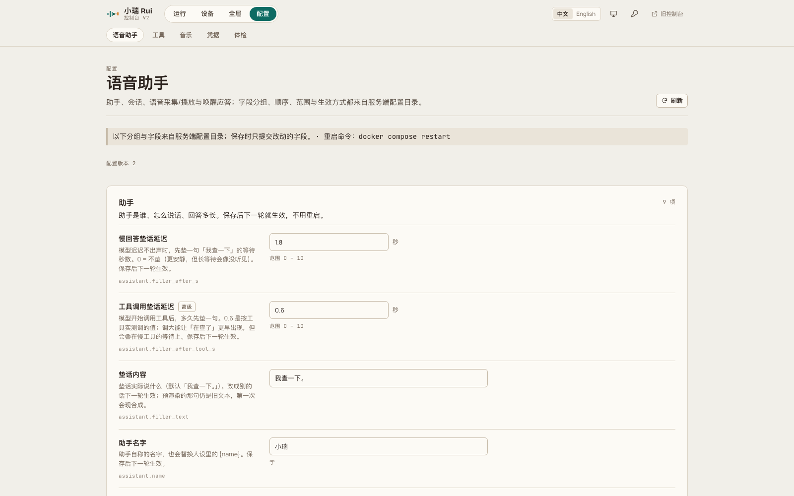

<div align="center">

# 小瑞 · rui

**把家里的音箱变成只属于你的语音助手。**
*Turn the speakers you already own into a voice assistant that answers to you.*

[](https://github.com/yes999zc/rui/actions/workflows/ci.yml)
[](https://github.com/yes999zc/rui/actions/workflows/secret-scan.yml)
[](https://github.com/yes999zc/rui/actions/workflows/docker-publish.yml)
[](LICENSE)
[](https://github.com/yes999zc/rui/releases)

</div>



---

# 中文

## 15 秒了解

家里已有的音箱继续用它们自己的麦克风和喇叭，但唤醒词、对话、记忆、音乐都走你自己的服务：一台机器上的 `rui` 服务 + 每种音箱一个桥接插件。控制台 `/v2` 可以加设备、改配置、看日志和轨迹，不用再手改 YAML。

```text
说「你好小瑞」→ 它答「在呢」→ 说「放首歌」→ 播放中再说「下一首」→ 说「退下吧」→ 结束这一轮
```

## 分层架构


架构图源文件：[`docs/assets/architecture.mmd`](docs/assets/architecture.mmd)；导出物 [`architecture.svg`](docs/assets/architecture.svg) / [`architecture.png`](docs/assets/architecture.png)（Mermaid；改配色后重新导出即可）。

| 层 | 职责 | 关键点 |
|---|---|---|
| **服务端（控制面）** | 会话与回合、工具调用、LLM/TTS/ASR 供应商、唤醒仲裁、v2 控制台 API、配置与密钥 | 一轮对话只由一台设备承担；播放态与回合按**房间**隔离，一屋放歌不会让另一屋变聋 |
| **音频平面** | 每台设备一个独立进程：拾音、KWS/VAD 门限、预录缓冲、回声切除、送 ASR、播放队列 | 门限在本地做，服务端只做决策；播放与唤醒的自回声有专门的剔除路径 |
| **设备（插件）** | 每种音箱一个 `rui-device/v1` 桥接插件：设备长连接、上下行音频、指示灯与按键 | 核心不含设备专用逻辑；加一种音箱 = 加一个插件仓库 |

## 特性

- **多设备、按房间隔离**：设备按房间分组，唤醒与播放的互斥只在本房间生效，跨房间互不影响。
- **播放中打断（barge-in）**：播放时唤醒立即停播并进入对话，服务端停播延迟以毫秒计。
- **自回声抑制**：唤醒提示音（「在呢」）不会变成一次用户输入；普通唤醒撞上进行中的告别语时，会丢弃已排队的我方语音。
- **可插拔设备**：`dot2` / `xiaoai` 两个桥接插件遵循同一份 `rui-device/v1` 契约，桥与核心可独立升级。
- **控制台 v2**：设备、房间、配置分组、日志、轨迹、音乐、凭据、体检；中英双语，字段说明来自服务端目录。
- **本地优先**：模型与密钥都在你自己的机器上；配置文件是唯一事实来源，控制台只提交你改过的字段。

## 三行启动

```bash
git clone --branch v0.7.2 https://github.com/yes999zc/rui.git && cd rui
bash deploy/install.sh                      # 生成 compose / config / .env 并启动
cat console-token.txt                       # 控制台 token（也可用 rui token 重新读取）
```

装完打开 `http://127.0.0.1:8080/v2/`，用上面的 token 登录，在「设备」页添加第一台音箱。

## 兼容性与前置条件

- Python **3.11+**；Docker 与 Docker Compose（推荐镜像 `ghcr.io/yes999zc/rui:0.7.2`）。
- 需要自备 **LLM / TTS / ASR** 供应商（在配置文件里填，或使用本地模型）。没有凭据时服务能起，但对话链路不会工作。
- 设备前置条件（第三方设备，与厂商**无官方关联**）：
  - EchoMuse Dot2（RS03QR）：固件需已具备设备本地接口，并与本服务在同一局域网；设备侧音频参数由桥接插件下发。
  - 小米 LX06 一类设备：仅支持已开放本地接口的固件版本；本项目不提供、也不建议任何刷机或越权步骤。
- 播放音乐需要自备音乐源（如 Navidrome）；未配置时「放首歌」会明确报错，不会静默失败。

## 支持矩阵

> 数字来自 2026-10-26 的实测；**未测项一律标「未测」**，不要当作已支持。

| 能力 | Dot2（EchoMuse RS03QR） | LX06（第三方设备） |
|---|---|---|
| 唤醒 | 30/30 admitted（2026-10-26，6 句 × 5 轮，校准后 TTS 音源） | 19/20（历史实测） |
| 语音指令 | 26/30（同上，含音乐占据扬声器的场景） | 未测 |
| 播放中打断 | 8/8（2026-10-26，真机人声） | 205.2 ms 停播延迟（历史实测） |
| 音量控制 | 未测 | 未测 |
| 指示灯 | 未测 | 未测 |
| 多设备并发 | 未测 | 未测 |
| 音乐中短指令（下一首 / 停止播放） | 10/10（2026-10-26，人声，1 m） | 未测 |

## 故障排查

| 现象 | 原因 | 处置 |
|---|---|---|
| 喊了唤醒词没反应 | 设备未连接，或被同房间的另一轮对话占住 | 看「运行」页的告警项；确认该房间没有未结束的回合 |
| 唤醒后它自问自答 | 唤醒提示音被当成用户输入 | 0.7.2 已修；仍出现请附 `cue_gate` 日志行提 issue |
| 播放中说什么都不理 | 音乐占着扬声器时部分回答会被设计性跳过 | 属预期行为：换歌 / 停播仍会执行，只是不回话 |
| 放歌后要靠近才听得清 | 早期是测试音源电平太低造成的假象 | 先按 `docs/analysis/wake-vs-command-range.md` §7 校准音源，再判断是否设备问题 |
| 加第二台 Dot2 后第一台失效 | `DOT2_CONTROL_PORT` 是全局环境变量 | 加设备前清掉该变量，按设备分配 `listen_port` |
| 控制台打不开 | 端口 / 防火墙，或 token 过期 | `docker compose ps` 看容器；`rui token` 重新取 token |
| 升级后设备掉线 | 新镜像未包含对应桥接插件版本 | 用下游组合镜像（`rui-dot2:x.y.z`），不要用纯核心镜像 |

## 已知限制

- 唤醒提示音的回声在「冷启动 + 不削波 + 设备播放延迟 > 800 ms」或「用户与提示音重叠 < 110 ms」时仍可能漏进 ASR。
- 对话运行器目前是单会话：一台设备唤醒时会中止另一台正在合成的回复（按房间隔离目前只覆盖播放与回合仲裁）。
- 已播出的告别语尾音无法追回，只能阻止后续语音块。
- 唤醒词暂不按房间隔离；多台设备的并发能力未测。

## 致谢

设计上参考了同类项目的公开做法：Rhasspy 的分域式服务拆分、Wyoming 的协议层抽象、openWakeWord 对「未测 / 限制」的诚实标注。实现全部为本仓库原创代码。

## License

[MIT](LICENSE)。

---

# English

## In 15 seconds

Your existing speakers keep their own microphones and speakers, but wake words, dialogue, memory and music run on your own machine: one `rui` service plus one bridge plug per speaker model. The `/v2` console adds devices, edits configuration and shows logs and traces — no YAML editing required.

```text
"Hey Rui" → "I'm here" → "play some music" → "next" (while playing) → "stand down" → turn ends
```

## Layered architecture


Source: [`docs/assets/architecture.mmd`](docs/assets/architecture.mmd); exports [`architecture.svg`](docs/assets/architecture.svg) / [`architecture.png`](docs/assets/architecture.png) (Mermaid; re-export after changing colours).

| Layer | Responsibility | Why it matters |
|---|---|---|
| **Server (control plane)** | Sessions and turns, tool calls, LLM/TTS/ASR providers, wake arbitration, the v2 console API, configuration and secrets | Exactly one device owns a turn; playing state and turns are scoped **per room**, so music in one room never deafens another |
| **Audio plane** | One process per device: capture, KWS/VAD gate, preroll buffer, echo excision, ASR feed, playback queue | Gating stays local, decisions stay on the server; self-echo has a dedicated excision path |
| **Devices (plugs)** | One `rui-device/v1` bridge per speaker model: device link, uplink/downlink audio, LED and buttons | The core has no device-specific logic; a new speaker is a new plug repository |

## Features

- **Per-room isolation**: devices are grouped by room; wake and playback exclusion applies only inside a room.
- **Barge-in**: a wake during playback stops the audio immediately and starts a turn, with millisecond-scale stop latency on the server side.
- **Self-echo suppression**: the acknowledgement cue never becomes user input, and a stale goodbye still queued is dropped when a wake arrives.
- **Pluggable devices**: the `dot2` and `xiaoai` bridges share one `rui-device/v1` contract and version independently.
- **Console v2**: devices, rooms, grouped configuration, logs, traces, music, credentials and health checks; bilingual UI fed by a server-side catalog.
- **Local first**: models and keys stay on your machine; the config file is the source of truth and the console submits only changed fields.

## Three-line quickstart

```bash
git clone --branch v0.7.2 https://github.com/yes999zc/rui.git && cd rui
bash deploy/install.sh                      # writes compose / config / .env, then starts
cat console-token.txt                       # console token (or: rui token)
```

Open `http://127.0.0.1:8080/v2/`, log in with that token, and add your first speaker on the Devices page.

## Compatibility and prerequisites

- Python **3.11+**, Docker and Docker Compose (recommended image: `ghcr.io/yes999zc/rui:0.7.2`).
- Your own **LLM / TTS / ASR** providers (configured in the config file, or local models). The service starts without credentials, but the dialogue path stays idle.
- Device prerequisites (third-party hardware, **not affiliated with any vendor**):
  - EchoMuse Dot2 (RS03QR): firmware must already expose the device's local interface and be on the same LAN; audio parameters are pushed by the bridge.
  - Xiaomi LX06-class devices: only firmware that already exposes a local interface is supported. No flashing, rooting or privilege-escalation steps are provided or endorsed.
- Music needs your own source (e.g. Navidrome); without one, "play some music" fails loudly instead of silently.

## Support matrix

> Measured on 2026-10-26. Anything untested is marked **untested** — do not read it as supported.

| Capability | Dot2 (EchoMuse RS03QR) | LX06 (third-party) |
|---|---|---|
| Wake | 30/30 admitted (2026-10-26, 6 phrases × 5 rounds, calibrated TTS source) | 19/20 (historical) |
| Voice commands | 26/30 (same run, including music-owns-speaker cases) | untested |
| Barge-in during playback | 8/8 (2026-10-26, real voice) | 205.2 ms stop latency (historical) |
| Volume control | untested | untested |
| LED | untested | untested |
| Concurrent multi-device | untested | untested |
| Short commands during music (next / stop) | 10/10 (2026-10-26, human voice, 1 m) | untested |

## Troubleshooting

| Symptom | Cause | Fix |
|---|---|---|
| Wake word does nothing | Device offline, or another turn owns the room | Check the alerts on the Run page; make sure no turn is left open in that room |
| It answers itself | The acknowledgement cue was transcribed as user speech | Fixed in 0.7.2; if it still happens, attach the `cue_gate` log lines to an issue |
| No response while music plays | When music owns the speaker, some replies are skipped by design | Expected: track changes and stop still execute, they just do not speak |
| Commands only work up close | Earlier runs used a test source that was too quiet | Calibrate the source first (`docs/analysis/wake-vs-command-range.md` §7) before blaming the device |
| A second Dot2 breaks the first | `DOT2_CONTROL_PORT` is a global environment variable | Unset it, then assign a `listen_port` per device |
| Console does not load | Port/firewall, or an expired token | `docker compose ps`, then `rui token` for a fresh token |
| Devices drop after an upgrade | The new image lacks the matching bridge version | Deploy the combined image (`rui-dot2:x.y.z`), not the bare core |

## Known limitations

- Cue echo can still slip into ASR on a cold start with no clipping and >800 ms device latency, or when the user overlaps the cue by less than 110 ms.
- The dialogue runner is single-session: a wake on one device aborts a reply being synthesised for another (per-room isolation currently covers playback and turn arbitration only).
- A goodbye that has already been spoken cannot be recalled; only queued chunks are dropped.
- Wake words are not yet isolated per room, and concurrent multi-device behaviour is untested.

## Credits

The design borrows patterns that are public in comparable projects: Rhasspy's domain split, Wyoming's protocol layer, and openWakeWord's habit of labelling untested areas. All code here is original to this repository.

## License

[MIT](LICENSE).
