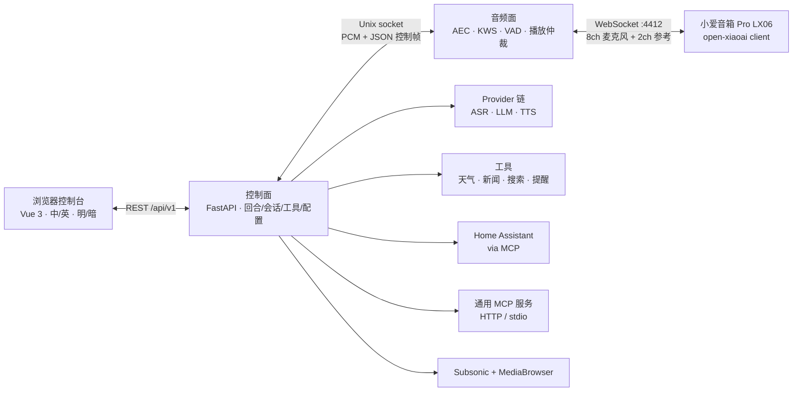

<div align="center">
  
  <h1>小瑞 · Rui</h1>
  <p><strong>把家里的音箱，变成只属于你的语音助手。</strong><br>
  <em>Turn the speaker you already own into a private voice assistant.</em></p>
  <p>
    <a href="https://github.com/yes999zc/rui/actions/workflows/ci.yml">
      
    </a>
    <a href="https://github.com/yes999zc/rui/actions/workflows/secret-scan.yml">
      
    </a>
    <a href="https://github.com/yes999zc/rui/actions/workflows/docker-publish.yml">
      
    </a>
    <a href="LICENSE">
      
    </a>
    <a href="https://github.com/yes999zc/rui/releases/latest">
      
    </a>
  </p>
  <p><a href="#中文">中文</a> · <a href="#english">English</a></p>
</div>

> **Name note:** repository, image, Python package, CLI, config paths and environment variables are all
> `rui`; 0.1.x upgrades use the [migration guide](docs/migration-house-ear-to-rui.md).

---

## 中文

### 0.5.0 有什么新东西

> **0.5.1（2026-10-25）是安装路径 patch，无运行时/契约变化。** `install.sh` 不再执行 `.env` 模板注释里的命令、也不再打印 console token；`fetch-models` 对 429/5xx 重试，模型失败时安装器非零退出；`rui doctor` 新增 `models` 就绪行。README 也加了「让 Agent 帮你安装」复制块。
>
> **0.5.0（2026-10-25）交付「多设备 0.5」：一台控制面驱动多个房间的音箱，唤醒由中枢统一仲裁。**
>
> - **多平面 + 中央仲裁**：每台启用入站音箱一个受监督音频面；候选 → 合并窗口 → `wake_admit`/`wake_reject`，全屋同时刻一个回合、一个输出 owner；barge 只归播放设备、同房间交叉回声抑制、同词去重、超 `max_planes` 明确告警、单平面崩溃隔离。
> - **每设备音频覆盖（config v3）**：`devices[].audio.*` 覆盖 AEC 归属/开关、播放后静音 `post_playback_mute_ms`、续听、播放预缓冲与采集布局；`multi_device` 块默认关闭，v2 文件保持 v2。
> - **逐设备健康与控制台**：`/health` 保留旧字段并新增 `audio_devices[]` 与 `multi_device`；体检页有「未启用多设备 / 逐平面状态」卡片，配置中心新增 `multi_device` 组与每设备 audio 覆盖字段。
> - **下游升级**：`rui_compat` 上界抬到 `<0.6.0`（0.5.0 会让旧上界失效）；`docs/deploy.md` §7.1 给带 out-of-tree adapter 的安装写了升级/回滚/兼容矩阵；healthcheck 直接说根因（adapter 不兼容、fleet 启动失败、哪个房间的平面没起来），不再只让你 restart。
> - **设备/插件契约变化 = 无**：adapter/manifest 接口、`drain_wakes()` 时序、`DeviceWake` 六字段不变；真机 LX06 + 2×Dot2 验收由 9哥 保留。
>
> 0.4.2 的更新见 [v0.4.2](https://github.com/yes999zc/rui/releases/tag/v0.4.2)。
>
> [v0.5.0 Release](https://github.com/yes999zc/rui/releases/tag/v0.5.0) · [CHANGELOG](CHANGELOG.md) ·
> [对比 v0.4.2...v0.5.0](https://github.com/yes999zc/rui/compare/v0.4.2...v0.5.0)

### 这是什么

小瑞（Rui）是一个**自托管、本地优先**的家庭语音终端：一台你拥有的音箱通过 WebSocket 拨入 NAS，唤醒、AEC、VAD、播放和本地 ASR 都在你自己的机器上完成。默认不依赖厂商云；只有你显式配置的 provider 会收到请求。

- **完整回合本地编排**：唤醒 → 分段 → ASR → LLM（可调工具）→ 流式 TTS → 推回音箱。
- **一个控制台管全部**：中英双语、明暗主题、两分组导航；供应商/音源预设、只写凭据、设备管理、向导、诊断与日志。
- **一条命令部署到 NAS**：Docker Compose + amd64/arm64 镜像；配置/数据/模型在卷里，音频面崩溃由 watchdog 拉起。

### 界面

<p align="center"></p>
<p align="center"><em>总览：真实信号、试一试、音频面遥测。</em></p>

<table>
  <tr>
    <td width="50%"></td>
    <td width="50%"></td>
  </tr>
  <tr>
    <td><em>模型与语音服务：LLM/ASR/TTS 三段链路、预设、就绪徽章与试听。</em></td>
    <td><em>首次运行向导：密钥、模型、设备准备/接线、测试、试一句。</em></td>
  </tr>
</table>

> 截图来自真实控制台（v0.5.0），已隐去内网地址和本机路径。

### 30 秒快速开始

**前置**：Linux NAS（amd64/arm64，4 核 / 4 GB 内存 / 2 GB 磁盘），Docker Engine + `docker compose`；
音箱已运行 [open-xiaoai](https://github.com/coderzc/open-xiaoai) client，并与 NAS 同 LAN/L2。

```bash
curl -4 -fsSL https://raw.githubusercontent.com/yes999zc/rui/v0.5.1/deploy/install.sh \
  | RUI_REF=v0.5.1 RUI_IMAGE=ghcr.io/yes999zc/rui:0.5.1 sh
```

首次含镜像拉取和 239 MB 模型通常 **4–8 分钟**；镜像已就绪、只需 ASR 时约 **85 秒**。滚动版本把 tag 换成 `main` 即可。

安装后打开 `http://<nas-lan-ip>:8080/`，输入 console token（0.4.1+ 存在 `~/rui/console-token.txt`；
缺失时运行 `cd ~/rui && docker compose exec -T rui rui token`）。**必须用 NAS 的局域网 IP**，
否则 `connect` 会生成 `127.0.0.1` 地址。目录权限、代理、源码回退和手动 Compose 见 [docs/deploy.md](docs/deploy.md)。

### 让 Agent 帮你安装（推荐）

如果你本机已有能执行命令的 AI Agent（Claude Code / Codex / Cursor Agent 等），把下面整段复制给它。
它会先读官方公开文档，再按官方安装脚本部署，并在需要时主动问你配置：

```text
你是一名在 Linux NAS 上部署自托管服务的工程师。请帮我安装 rui（小瑞）最新稳定版：
1. 先读 https://github.com/yes999zc/rui 的 README、docs/deploy.md §2 和 docs/first-run.md，只读公开文档，不要改仓库代码；
2. 按 docs/deploy.md 的官方 install.sh 安装，固定 release tag，不要用 main；
3. 动手前先问我：NAS 安装目录（默认 ~/rui）、Docker 是否可用、音箱型号和局域网地址、唤醒词、LLM/ASR/TTS 的 key、是否要开 Telegram/音乐/Home Assistant，以及我的城市；
4. key/token 只通过交互输入或写成 0600 文件，不要写进日志、聊天或 git；
5. 装完运行 rui-healthcheck 和一次真实回合；任何一步失败就停下把错误发我，不要静默跳过或假装成功。
```

装好后按下面的「第一次运行」完成 8 步向导即可。

### 第一次运行

安装后控制台进入 `/setup`，8 步都在浏览器完成；最少凭据是 **LLM + TTS**（ASR 默认本地 SenseVoice）。
8 步是 `keys → models → prepare → params → wake → connect → test → verify`，每步可重跑，正常路径不需要手改 YAML。
完整 8 步表、参数来源、连接排障和安装后命令见 [docs/first-run.md](docs/first-run.md)：
[8 步向导](docs/first-run.md#八步向导) · [参数来源](docs/first-run.md#音箱参数从哪来) ·
[连接排障](docs/first-run.md#连接接线与排障) · [安装后命令](docs/first-run.md#安装后命令速查)。

### 功能

| 领域 | 能力 |
|---|---|
| 语音回合 | 唤醒 → 分段 → ASR → LLM + 工具 → 流式 TTS → 播放；音频面负责 AEC、KWS、VAD、播放仲裁 |
| ASR / TTS | 本地 SenseVoice（默认）、火山流式 ASR 2.0、讯飞/火山豆包 TTS；按音色/语速/情感试听 |
| 供应商 | 11 个 LLM 预设 + 自定义 OpenAI 兼容端点；预设创建、保存前探测、就绪/缺配置徽章、只写密钥 |
| 音乐 | Subsonic 家族（Navidrome/Airsonic/Gonic/Ampache）+ Jellyfin/Emby + custom；搜索/随机/收藏/播放，真实连接测试 |
| 工具与集成 | 天气/新闻/搜索/提醒/记忆；Home Assistant 第一方 MCP（六工具白名单/危险域硬拒）；通用 MCP（headers + 只写 `token_env`/stdio 闸） |
| 控制台 | 中英双语、明暗主题、两分组约 12 个入口；总览/对话/记忆/日志/体检 |
| 设备与插头 | Socket/Plug v1（manifest/能力/`device_wake`）、LX06 参考插头、设备状态/启停/token 轮换 |
| 通道与运维 | Telegram/微信 iLink；多架构镜像、非 root 容器、last-good 配置恢复、备份/恢复、CVE 扫描、SSRF 出站守卫 |

### 架构



几条固定规则：

1. **只有音频面碰麦克风和音箱**；控制面不直接向设备写音频。
2. **播放只有一个 owner**：提示音 P0 → 回答 P1 → 提醒 P2 → 音乐 P3。
3. **设备拨入，控制面不主动连设备**。
4. 机型差异只进 adapter/plugin + manifest。

分层/进程/IPC 见 [docs/architecture.md](docs/architecture.md)，音频链路见 [docs/audio-pipeline.md](docs/audio-pipeline.md)，
插头契约见 [docs/socket-plug-v1.md](docs/socket-plug-v1.md)。

### 支持与状态

| 范围 | 状态 |
|---|---|
| 发布 | **0.5.1**（2026-10-25）；0.5.0 多设备 + 安装路径 patch |
| 镜像 / 质量 | `ghcr.io/yes999zc/rui:0.5.1`，amd64+arm64；1,293 passed / 18 skipped；ruff、web build、secret-scan 绿 |
| 宿主 | Linux NAS（amd64/arm64），Docker + compose |
| 音箱 | LX06 + open-xiaoai client（同 LAN/L2，回连 `4412`）；dot2 走外部 `rui-dot2-bridge` |
| 音源 | Subsonic 家族 + Jellyfin/Emby（MediaBrowser）；Plex 尚未实现 |
| 开发 | macOS/Linux 可 `uv run rui serve`；生产形态是 NAS 容器 |

**v1 验收**（2026-10-24，真实 NAS + LX06）：冷装 423 s；80% 音量放歌 19/20 唤醒；打断 max 205.2 ms。

### 已知限制

- **多设备默认关闭**：0.5.0 支持单实例多平面 + 中央仲裁，但 `multi_device.enabled` 默认 false（保持 0.4.x 语义）；启用前读 [docs/multi-device-design.md](docs/multi-device-design.md)，真机 LX06 + 2×Dot2 验收由 9哥 保留。
- **只支持 LX06**：需要 open-xiaoai client、同 LAN/L2；刷机/装 client 属于上游，Rui 不代刷。
- **第三方插头隔离**：sidecar、签名/allowlist、多设备 owner 仲裁尚未交付；in-process 需可信 manifest。
- **音乐协议**：Plex 尚未实现；新增协议需要适配器。
- **控制台收尾**：Phase 4 已完成；旧 legacy 面板/路由不再兼容（有意）。
- **体验欠账**：手机对话、音乐收藏/口味 UI 等见 [docs/remaining-work.md](docs/remaining-work.md)。
- **生产微信**：Telegram 已生产验证；微信 iLink 接口保留，生产验证未完成。

### 文档

- 入门：[first-run](docs/first-run.md) · [deploy](docs/deploy.md) · [runbook](docs/runbook.md) · [open-xiaoai 接入](docs/open-xiaoai-client.md)
- 参考：[architecture](docs/architecture.md) · [security](docs/security.md) ·
  [security-scanning](docs/security-scanning.md) · [config catalog](docs/config-catalog-contract.md)
- 控制台与音频：[console](docs/console.md) · [console IA audit](docs/console-ia-audit.md) · [audio pipeline](docs/audio-pipeline.md)
- 功能：[provider presets](docs/provider-presets.md) · [music sources](docs/music-sources.md) ·
  [MCP/HA](docs/integrations-mcp.md) · [Socket/Plug v1](docs/socket-plug-v1.md)
- 项目：[CHANGELOG](CHANGELOG.md) · [releases](docs/releases/) · [ROADMAP](docs/ROADMAP.md) · [remaining work](docs/remaining-work.md)
- 开发：[deploy](docs/deploy.md) · [runbook](docs/runbook.md)
- 版本：[v0.5.1](https://github.com/yes999zc/rui/releases/tag/v0.5.1) · [v0.5.0](https://github.com/yes999zc/rui/releases/tag/v0.5.0) · [v0.4.2](https://github.com/yes999zc/rui/releases/tag/v0.4.2)

### 安全与隐私

- **本地优先**：音频、KWS/VAD/AEC、本地 ASR 都在你的机器上；只有你配置的 LLM/TTS/搜索/音乐/HA/MCP 服务收到请求。
- **密钥只写不读**：`.env` / `data/secrets.yaml`（0600）；provider 草稿密钥只在内存；音乐凭据在 `lan_media.json`（0600）；接口只回 `has_key`/`has_value`。
- **控制台与非 root 容器**：随机 token，非 loopback 无 token 拒绝启动；容器 uid/gid 1000、只读根文件系统、`cap_drop: ALL` + `no-new-privileges`。
- **出站与供应链**：SSRF 守卫（默认允许内网、拒绝回环/云元数据）；CI 跑 pip-audit/Trivy/secret-scan；设备 token 等同音箱控制权。细节见 [docs/security.md](docs/security.md)。
- 漏洞请勿公开开 issue，先通过 GitHub 私下联系维护者。

### 致谢

- [open-xiaoai](https://github.com/coderzc/open-xiaoai) — 音箱端 client 与 LX06 回连协议（MIT）
- [EchoMuse](https://github.com/wilbowes/EchoMuse) — 设备管理后台参考实现（MIT，未直接分发）
- [sherpa-onnx](https://github.com/k2-fsa/sherpa-onnx) — 本地 ASR / 唤醒词运行时（Apache-2.0）
- [SenseVoice](https://github.com/FunAudioLLM/SenseVoice) — 本地语音识别模型（FunASR Model License，非 MIT）
- [Silero VAD](https://github.com/snakers4/silero-vad) — 语音活动检测（MIT）
- [SpeexDSP](https://github.com/xiph/speexdsp) — 回声消除（BSD-3-Clause）
- [FFmpeg](https://ffmpeg.org/) — 音乐/语音转码（LGPL-2.1+）

各组件保留自己的许可证；完整清单见 [THIRD_PARTY.md](THIRD_PARTY.md)。

### License 与品牌

代码以 **MIT** 发布，见 [LICENSE](LICENSE)；`小瑞 / Rui` 名称与 logo 是项目品牌资产，不随 MIT 授权用于其他产品品牌。

---

## English

### What's new in 0.5.0

> **0.5.1 (2026-10-25) is an install-path patch with no runtime/contract change.** `install.sh` no longer runs commands from its `.env` template comments and never prints the console token; `fetch-models` retries 429/5xx and a model failure now fails the install; `rui doctor` reports local ASR/VAD/KWS readiness. The README also gained a copy-paste agent-install prompt.
>
> **0.5.0 (2026-10-25) ships multi-device 0.5: one control plane drives several rooms and the wake decision is made centrally.**
>
> - **Multi-plane + central arbitration:** one supervised audio plane per enabled inbound speaker; candidates collect for a merge window, then `wake_admit`/`wake_reject` - one turn and one output owner for the house. Barge belongs to the playing room, same-room cross-echo is suppressed, the same word is deduplicated, overflow over `max_planes` is named, and one crashed plane stays isolated.
> - **Per-device audio overrides (config v3):** `devices[].audio.*` overrides AEC ownership/switch, post-playback mute `post_playback_mute_ms`, follow-up, playback prebuffer and capture layout; the `multi_device` block is off by default and v2 files stay v2.
> - **Per-plane health and console:** `/health` keeps its old fields and adds `audio_devices[]` plus `multi_device`; the Health page shows an off/on multi-device card with per-plane state, and the config center gained the `multi_device` group and the per-device audio overrides.
> - **Downstream upgrades:** the `rui_compat` ceiling moves to `<0.6.0` (old ceilings stop matching in 0.5.0); `docs/deploy.md` section 7.1 covers upgrading an install with an out-of-tree adapter, rollback and the compatibility table; the healthcheck now names the root cause (incompatible adapter, fleet start failure, which room is down) instead of only suggesting a restart.
> - **No device/plug contract change:** adapter/manifest interfaces, `drain_wakes()` timing and the `DeviceWake` six fields are unchanged; real-device LX06 + 2xDot2 acceptance is reserved for 9哥.
>
> 0.4.2 notes: [v0.4.2](https://github.com/yes999zc/rui/releases/tag/v0.4.2).
>
> [v0.5.0 Release](https://github.com/yes999zc/rui/releases/tag/v0.5.0) · [CHANGELOG](CHANGELOG.md) ·
> [Compare v0.4.2...v0.5.0](https://github.com/yes999zc/rui/compare/v0.4.2...v0.5.0)

### What it is

**Rui (小瑞)** is a self-hosted, local-first voice endpoint for a speaker you already own: a Xiaomi LX06
running the open-xiaoai client dials into your NAS over WebSocket, while wake word, AEC, VAD, playback and
local ASR stay on your machine. No vendor cloud is required; only the providers you configure see requests.

- **The full turn runs locally:** wake → segment → ASR → LLM (with tools) → streaming TTS → back to the speaker.
- **One console for everything:** bilingual zh/en, light/dark, two groups; provider/music presets,
  write-only credentials, devices, wizard, diagnostics and logs.
- **One command to a NAS:** Docker Compose + amd64/arm64 images; config/data/models in volumes, with an audio-plane watchdog.

### Screenshots

<p align="center"></p>
<p align="center"><em>Overview: live signals, try-it composer and audio-plane telemetry.</em></p>

<table>
  <tr>
    <td width="50%"></td>
    <td width="50%"></td>
  </tr>
  <tr>
    <td><em>Models & voice services: LLM/ASR/TTS chains, presets, readiness and audition.</em></td>
    <td><em>First-run wizard: keys, models, device prep/hookup, test and one sentence.</em></td>
  </tr>
</table>

> Captures come from a real console (v0.5.0); LAN addresses and local paths are redacted.

### 30-second quick start

**Prerequisites:** Linux NAS (amd64/arm64, 4 cores / 4 GB RAM / 2 GB disk) with Docker Engine +
`docker compose`; the speaker already runs [open-xiaoai](https://github.com/coderzc/open-xiaoai) on the same LAN/L2.

```bash
curl -4 -fsSL https://raw.githubusercontent.com/yes999zc/rui/v0.5.1/deploy/install.sh \
  | RUI_REF=v0.5.1 RUI_IMAGE=ghcr.io/yes999zc/rui:0.5.1 sh
```

A first run with an image pull and the 239 MB model usually takes **4–8 minutes**; with the image already
local and only ASR to fetch, about **85 seconds**. Replace the tag with `main` for the rolling release.

Open `http://<nas-lan-ip>:8080/` and enter the console token (0.4.1+ writes `~/rui/console-token.txt`; if
missing, run `cd ~/rui && docker compose exec -T rui rui token`). **Use the NAS LAN IP**, or `connect`
generates a `127.0.0.1` URL. Host requirements, proxies, source fallback and manual Compose: [docs/deploy.md](docs/deploy.md).

### Let an agent install it (recommended)

If you already run a command-capable AI agent (Claude Code / Codex / Cursor Agent, etc.), paste the block
below into it. The agent reads the public docs first, installs with the official script, and asks you for
the settings it needs:

```text
You are an engineer deploying a self-hosted service on a Linux NAS. Please install rui (小瑞), the latest
stable release:
1. Read the README, docs/deploy.md section 2 and docs/first-run.md at https://github.com/yes999zc/rui first;
   read only the public docs and do not modify the repository code.
2. Install with the official install.sh from docs/deploy.md, pinning a release tag (never main).
3. Before acting, ask me for: the install directory (default ~/rui), whether Docker is available, the
   speaker model and LAN address, wake words, the LLM/ASR/TTS keys, whether to enable Telegram / music /
   Home Assistant, and my city.
4. Keep keys and tokens in interactive input or 0600 files only; never write them to logs, chat or git.
5. After the install, run rui-healthcheck and one real turn. If any step fails, stop and show me the error;
   do not skip it silently or pretend it succeeded.
```

Then complete the eight-step wizard under "First run" below.

### First run

The console opens `/setup`; all eight steps are in the browser, and the minimum credentials are
**LLM + TTS** (ASR defaults to local SenseVoice). The steps are
`keys → models → prepare → params → wake → connect → test → verify`; each can be rerun and the normal path
needs no YAML edits. Full step tables, parameter sources, connection troubleshooting and after-install
commands: [docs/first-run.md](docs/first-run.md) · [8-step wizard](docs/first-run.md#the-8-step-wizard) ·
[parameter sources](docs/first-run.md#where-each-param-comes-from) ·
[connect troubleshooting](docs/first-run.md#connect-troubleshooting) ·
[after-install commands](docs/first-run.md#after-install-command-reference).

### Features

| Area | What you get |
|---|---|
| Voice turn | Wake → segment → ASR → LLM + tools → streaming TTS → playback; the audio plane owns AEC, KWS, VAD and playback arbitration |
| ASR / TTS | Local SenseVoice (default), Volc ASR 2.0, XFYUN/Volc TTS; audition by voice/rate/emotion |
| Providers | 11 LLM presets + custom OpenAI-compatible endpoints; create/probe presets, readiness badges, write-only keys |
| Music | Subsonic family (Navidrome/Airsonic/Gonic/Ampache) + Jellyfin/Emby + custom; search/random/favorites/playback, real connection test |
| Tools & integrations | Weather/news/search/reminders/memory; Home Assistant first-party MCP (six-tool whitelist, dangerous-domain refusal); generic MCP (headers + write-only `token_env`/stdio gate) |
| Console | Bilingual zh/en, light/dark, two groups and about 12 destinations; overview/turns/memory/logs/diagnostics |
| Devices & plugs | Socket/Plug v1 (manifest/capabilities/`device_wake`), LX06 reference plug, device status/start-stop/token rotation |
| Channels & ops | Telegram/WeChat iLink; multi-arch images, non-root container, last-good config recovery, backup/restore, CVE scanning, SSRF egress guard |

### Architecture


Hard rules:

1. **Only the audio plane touches mic/speaker**; the control plane never writes audio.
2. **Playback has one owner**: cue P0 → reply P1 → reminder P2 → music P3.
3. **Devices dial in**; the control plane does not dial out.
4. Device differences live in the adapter/plugin + manifest.

Layers/process/IPC: [docs/architecture.md](docs/architecture.md); audio: [docs/audio-pipeline.md](docs/audio-pipeline.md);
plug contract: [docs/socket-plug-v1.md](docs/socket-plug-v1.md).

### Support and status

| Scope | Status |
|---|---|
| Release | **0.5.1** (2026-10-25); 0.5.0 multi-device + install-path patch |
| Images / quality | `ghcr.io/yes999zc/rui:0.5.1`, amd64+arm64; 1,293 passed / 18 skipped; ruff, web build, secret-scan green |
| Host | Linux NAS (amd64/arm64), Docker + compose |
| Speaker | LX06 + open-xiaoai client (same LAN/L2, dials `4412`); dot2 via external `rui-dot2-bridge` |
| Music | Subsonic family + Jellyfin/Emby (MediaBrowser); Plex not implemented |
| Development | macOS/Linux can run `uv run rui serve`; the production form is a NAS container |

**v1 acceptance** (2026-10-24, real NAS + LX06): 423 s cold install; 19/20 wakes at 80% volume; barge max 205.2 ms.

### Known limitations

- **Multi-device is off by default:** 0.5.0 supports one instance with several planes and central arbitration, but `multi_device.enabled` defaults to false (0.4.x semantics); read [docs/multi-device-design.md](docs/multi-device-design.md) before enabling. Real-device LX06 + 2xDot2 acceptance is reserved for 9哥.
- **LX06 only:** needs the open-xiaoai client and same LAN/L2; flashing/client install are upstream, not done by Rui.
- **Third-party plugs:** sidecar isolation, signing/allowlists and multi-device owner arbitration are not shipped; in-process needs a trusted manifest.
- **Music protocols:** Plex is not implemented; a new protocol needs an adapter.
- **Console cleanup:** Phase 4 is complete; legacy panel routes no longer resolve (intentional).
- **UX debt:** mobile turns, music favorites/taste UI and more are in [docs/remaining-work.md](docs/remaining-work.md).
- **WeChat in production:** Telegram is production-verified; the WeChat iLink interface is kept, but production validation is still pending.

### Documentation

- Start: [first-run](docs/first-run.md) · [deploy](docs/deploy.md) · [runbook](docs/runbook.md) · [open-xiaoai hookup](docs/open-xiaoai-client.md)
- Reference: [architecture](docs/architecture.md) · [security](docs/security.md) ·
  [security-scanning](docs/security-scanning.md) · [config catalog](docs/config-catalog-contract.md)
- Console & audio: [console](docs/console.md) · [console IA audit](docs/console-ia-audit.md) · [audio pipeline](docs/audio-pipeline.md)
- Features: [provider presets](docs/provider-presets.md) · [music sources](docs/music-sources.md) ·
  [MCP/HA](docs/integrations-mcp.md) · [Socket/Plug v1](docs/socket-plug-v1.md)
- Project: [CHANGELOG](CHANGELOG.md) · [releases](docs/releases/) · [ROADMAP](docs/ROADMAP.md) · [remaining work](docs/remaining-work.md)
- Development: [deploy](docs/deploy.md) · [runbook](docs/runbook.md)
- Releases: [v0.5.1](https://github.com/yes999zc/rui/releases/tag/v0.5.1) · [v0.5.0](https://github.com/yes999zc/rui/releases/tag/v0.5.0) · [v0.4.2](https://github.com/yes999zc/rui/releases/tag/v0.4.2)

### Security and privacy

- **Local-first:** audio, KWS/VAD/AEC and local ASR stay on your machine; only the LLM/TTS/search/music/HA/MCP services you configure receive requests.
- **Write-only secrets:** `.env` / `data/secrets.yaml` (0600); provider draft keys stay in memory;
  music credentials live in `lan_media.json` (0600); APIs return only `has_key`/`has_value`.
- **Console and container:** random console token, non-loopback bind without one is refused; container runs
  as uid/gid 1000 with a read-only root filesystem, `cap_drop: ALL` + `no-new-privileges`.
- **Egress and supply chain:** SSRF guard (private networks allowed by default, loopback/cloud metadata
  refused); CI runs pip-audit/Trivy/secret-scan; the device token is equivalent to speaker control.
  Details: [docs/security.md](docs/security.md).
- Report vulnerabilities privately through GitHub instead of opening a public issue.

### Credits

- [open-xiaoai](https://github.com/coderzc/open-xiaoai) — speaker-side client and LX06 dial-in protocol (MIT)
- [EchoMuse](https://github.com/wilbowes/EchoMuse) — device-management console reference (MIT; no code shipped)
- [sherpa-onnx](https://github.com/k2-fsa/sherpa-onnx) — local ASR and wake-word runtime (Apache-2.0)
- [SenseVoice](https://github.com/FunAudioLLM/SenseVoice) — local speech-recognition model (FunASR Model License, not MIT)
- [Silero VAD](https://github.com/snakers4/silero-vad) — voice-activity detection (MIT)
- [SpeexDSP](https://github.com/xiph/speexdsp) — echo cancellation (BSD-3-Clause)
- [FFmpeg](https://ffmpeg.org/) — music/voice transcoding (LGPL-2.1+)

Each keeps its own license; the full inventory is in [THIRD_PARTY.md](THIRD_PARTY.md).

### License and brand

Code is released under **MIT**; see [LICENSE](LICENSE). The `小瑞 / Rui` name and logo are project brand assets, separate from the MIT grant.
