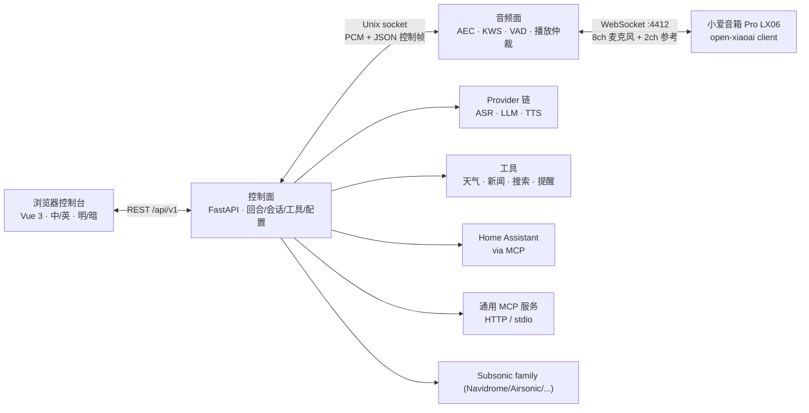
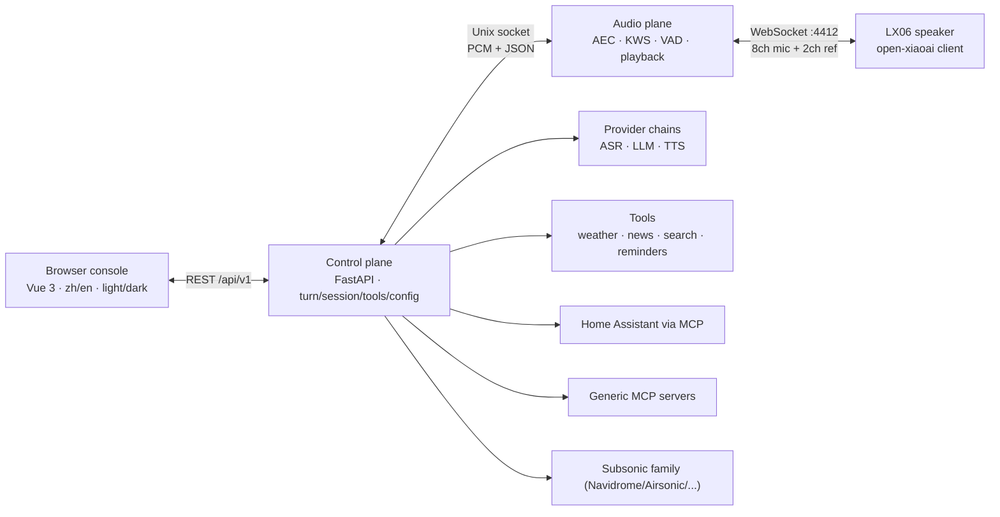

<div align="center">
  
  <h1>小瑞 · Rui</h1>
  <p><strong>把家里的音箱，变成只属于你的语音助手。</strong><br>
  <em>Turn the speaker you already own into a private voice assistant.</em></p>
  <p>
    <a href="https://github.com/yes999zc/rui/actions/workflows/ci.yml"></a>
    <a href="https://github.com/yes999zc/rui/actions/workflows/secret-scan.yml"></a>
    <a href="https://github.com/yes999zc/rui/actions/workflows/docker-publish.yml"></a>
    <a href="https://github.com/yes999zc/rui/blob/main/LICENSE"></a>
    
    
  </p>
  <p><a href="#中文">中文</a> · <a href="#english">English</a> · <a href="https://github.com/yes999zc/rui">GitHub</a></p>
</div>

> **项目名**：仓库、镜像、Python 包、CLI、配置路径和环境变量已统一为 `rui`；从 0.1.x 升级见 [迁移说明](docs/migration-house-ear-to-rui.md)。

---

## 中文

### 这是什么

小瑞（Rui）是一个**自托管、本地优先**的家庭语音终端。它不把麦克风音频交给云端语音助手，而是让一台你拥有的音箱通过 WebSocket 拨入家里的服务：

- **唤醒词、VAD、回声消除、播放都在本地音频面完成**；ASR 优先本地 SenseVoice，可选火山流式识别 2.0，云端只做兜底；
- **TTS 链可选讯飞与火山豆包 2.0**，控制台可按音色/语速/情感试听；**完整回合**：唤醒 → 分段 → ASR → LLM（可调工具）→ 流式 TTS → 推回音箱；
- **能力**：Home Assistant（作为第一方 MCP 实例，保留六工具白名单/危险域硬拒/`local.ha_*` 工具名）、通用 MCP 服务（HTTP `headers` + 只写 `token_env`/stdio 闸）、天气/新闻/联网搜索、提醒、记忆、Navidrome/Airsonic/Gonic/Ampache 或任意 Subsonic 兼容音源；
- **控制台 2.0**：中英双语、明暗主题、四层配置目录、类型化只写凭据、AI 供应商链路与音色试听、安装向导、诊断/日志（日志级别在日志页顶部）；
- **一条命令部署到 NAS**：Docker Compose + 多架构镜像，数据/配置/模型都在卷里；音频面崩溃由 watchdog 拉起。

v1 目前只支持 **Xiaomi 小爱音箱 Pro（LX06）**，且音箱需要运行 **open-xiaoai client** 来拨入本服务。一键安装只部署 NAS 服务，不会修改音箱。

### 界面

<p align="center">
  
</p>
<p align="center"><em>总览：真实信号、试一试、音频面遥测——不是占位数据。</em></p>

<table>
  <tr>
    <td width="50%"></td>
    <td width="50%"></td>
  </tr>
  <tr>
    <td><em>AI 供应商：三段链路、供应商卡片、音色选择与音箱/本机试听。</em></td>
    <td><em>首次运行向导：密钥、模型、设备准备/接线、测试、试一句。</em></td>
  </tr>
</table>

> 截图来自本地开发实例，已隐去 LAN 地址和个人路径；没有公开任何密钥或 token。

### 架构



几条固定规则：

1. **只有音频面碰麦克风和音箱**；控制面不直接向设备写音频。
2. **播放只有一个 owner**：唤醒提示音 P0 → 回答 P1 → 提醒 P2 → 音乐 P3；高优先级可以暂停/打断低优先级。
3. **设备拨入，控制面不主动连设备**（除了设备 client 自己暴露的有限 shell 通道）。
4. 设备、DSP、provider、工具之间只通过接口通信；新增一款音箱理论上只改一个 adapter 模块 + 一行注册。

更深入的分层、进程模型和 IPC 契约见 [docs/architecture.md](docs/architecture.md)，音频链路细节见 [docs/audio-pipeline.md](docs/audio-pipeline.md)。

### 安装 / Install

#### 0. 先决条件：音箱已经能拨入

小瑞从「音箱已经运行 open-xiaoai client，并能回连 NAS」开始。**刷机、拿 root/SSH、安装 client 都不属于小瑞**：请按 [open-xiaoai](https://github.com/coderzc/open-xiaoai) 项目完成；小瑞不刷机、不托管固件，也不会在音箱上执行命令。接线细节见 [docs/open-xiaoai-client.md](docs/open-xiaoai-client.md)。v1 只支持 **Xiaomi 小爱音箱 Pro（LX06）**，音箱和 NAS 在同一 LAN/L2，client 回连 NAS 的 `4412` 端口。

刷机/装 client 时，把下面这些记在手机备忘录里——后面每一步都要用，SSH 进不去时再猜最费时间：

| # | 记什么 | 后面用在哪 |
|---|---|---|
| 1 | 音箱型号/固件版本，以及 open-xiaoai client 的版本或 commit | `prepare` 的兼容性确认、排障、回滚 |
| 2 | 音箱的局域网 IP，以及路由器里的 **DHCP 固定租约** | `params` 的“音箱地址”；IP 一变，SSH 和回连地址都会失效 |
| 3 | SSH/root 登录方式：`ssh root@<speaker-ip>`、密码或密钥、刷机工具版本 | `prepare`、看日志、回滚 |
| 4 | client 安装路径（常见 `/data/open-xiaoai/`） | 重启 client、找日志、卸载/回滚 |
| 5 | client 保存回连地址/token 的位置：`server.txt`、`config.json`，或启动脚本里的 `WS_URL` / `SERVER_URL` | `connect` 填 ws 地址和 token |
| 6 | 重启 client 的命令，以及日志路径/查看命令（如 `tail -f <log>`） | `connect` / `test` 失败时先看这里 |
| 7 | 回滚方式：停止/移除 client、恢复原启动脚本；原厂固件/分区不要动 | `prepare` 的确认项、出问题时恢复 |
| 8 | RUI 的 device token 要填进 client 的哪个字段（完整 ws URL 或单独的 token 项） | `connect`；值来自 RUI，服务端与 client 必须一致 |

> ws 地址和 device token 等同于音箱控制权。不要发到公开群、截图或 issue 里；贴日志前先脱敏。

#### 1. 安装 RUI（约 1–5 分钟）

主机前置条件：

- **Docker Engine + `docker compose` 插件**；安装用户能访问 Docker daemon（`/var/run/docker.sock`）：root，或已加入 `docker` 组并重新登录（`docker info` 必须能通）。
- **可写安装目录**：默认 `~/rui`（`RUI_HOME` 可改）。`/vol1/rui` 这类 NAS 挂载点常是 root-only：用 root 安装，或先建目录并 `chown` 给安装用户。容器以 uid/gid **1000** 运行，安装脚本会把 `config/`、`data/` chown 到这个身份；1000 已被占用时用 `RUI_UID`/`RUI_GID` 覆盖（见 [docs/security.md](docs/security.md)）。
- **出网**：能访问 `raw.githubusercontent.com`、`ghcr.io`、`hf-mirror.com`。镜像拉取走 Docker daemon 的代理；模型下载可选宿主机代理——安装脚本会把 `HTTP_PROXY` / `HTTPS_PROXY` / `ALL_PROXY` / `NO_PROXY` 传给 `fetch-models`。
- **架构**：amd64 或 arm64；建议 4 核 / 4 GB 内存 / 2 GB 可用磁盘（另留约 250 MB 给模型）。

滚动版本（`main` + `:latest`，先试最省事）：

```bash
curl -4 -fsSL https://raw.githubusercontent.com/yes999zc/rui/main/deploy/install.sh | sh
```

生产建议固定发布版本（脚本、compose 文件和镜像都锁到同一个 tag）：

```bash
curl -4 -fsSL https://raw.githubusercontent.com/yes999zc/rui/v0.3.0/deploy/install.sh \
  | RUI_REF=v0.3.0 RUI_IMAGE=ghcr.io/yes999zc/rui:0.3.0 sh
```

装到 `/vol1/rui`（目录需可写）：

```bash
curl -4 -fsSL https://raw.githubusercontent.com/yes999zc/rui/v0.3.0/deploy/install.sh \
  | RUI_HOME=/vol1/rui RUI_REF=v0.3.0 RUI_IMAGE=ghcr.io/yes999zc/rui:0.3.0 sh
```

- `RUI_REF` 决定拉取的 `docker-compose.yml` / `config.example.yaml` 来自哪个 ref，`RUI_IMAGE` 决定运行哪个镜像；只固定一个，重装或回滚时仍可能换版本。
- `raw.githubusercontent.com` 卡住时用 `RUI_RAW` 指到镜像前缀，例如
  `RUI_RAW=https://ghproxy.net/https://raw.githubusercontent.com/yes999zc/rui/main`。
- `ghcr.io` 拉不动时，脚本会按 `RUI_REF` 从 `RUI_REPO` 的公开源码克隆并构建同一 tag（需要 `git`，日志会打印 ref/commit）。

安装脚本做五件事：

| 步骤 | 内容 | 落在哪 |
|---|---|---|
| 1 | 拉取 `docker-compose.yml`、`config.example.yaml`（参考件）和运维脚本 `backup.sh` / `restore.sh` / `acceptance-v1.py` | `~/rui/`、`~/rui/scripts/` |
| 2 | `rui setup` 写入生产配置模板，生成默认唤醒词 `keywords.txt` 和**控制台 token** | `~/rui/config/config.yaml`、`config/keywords.txt` |
| 3 | 生成 `.env`，含随机 device token（0600） | `~/rui/.env` |
| 4 | 准备本地模型：SenseVoice ASR（约 239 MB，一次）；VAD/KWS 从镜像 `/opt/seed-models` 复制 | `~/rui/data/models/` |
| 5 | `docker compose up -d`，等待 `/health` 通过（120 s 不通过则以非 0 退出） | 容器 `rui` |

期望输出（路径/地址随环境不同）：

```text
[1/5] compose file
[2/5] config + wake words
console token: <console-token>          ← 只在这里打印一次，先复制
[3/5] env
      wrote .env with a generated device token (48 hex chars)
[4/5] local models: ASR + VAD + wake word
      missing: asr-model; running fetch-models (image seed first)
[5/5] starting
      waiting for the service to answer /health
      healthy
done. open http://<nas-lan-ip>:8080/
```

镜像已在本机（或拉取很快）且只需下载 ASR 时，实测约 **85 秒**到 `healthy`；首次含镜像拉取和 239 MB 模型，按网络通常 **4–8 分钟**。日志里的 `console token` 和 `.env` 里的 device token 都要先收好。

打开 `http://<nas-lan-ip>:8080/`，输入控制台 token。**必须用 NAS 的局域网 IP 打开**：用 `localhost` 或 SSH 隧道打开时，`connect` 会按浏览器地址生成 `ws://127.0.0.1:4412`，音箱永远连不上。

```bash
cd ~/rui
docker compose exec -T rui rui token          # 找回控制台 token
docker compose exec -T rui rui token --rotate # 轮换（随后重启服务生效）
```

同一 `RUI_HOME` 可以安全重跑：如果 `rui` 容器属于本目录的 compose project，脚本直接 `docker compose up -d`（按需重建、补齐缺失模型）；容器属于其他目录/项目、或遇到 0.1.x 的 `house-ear` 容器时会报错并给出处理命令，不会擅自停删容器。

#### 2. 配置：首次运行向导的 8 步

安装完成后控制台会进入 `/setup`。正常路径全部在网页里完成，**不需要手改 YAML**；每一步都可以点开重跑。

| # | 步骤 | 点之前准备/决定 | 这一步做什么 | 完成标志 |
|---|---|---|---|---|
| 1 | `keys` | 决定 LLM / ASR / TTS 各用哪个 provider，准备对应凭据（见下表） | 写本地密钥文件，把该用途的 provider 链改为选中的一项，保存 TTS 音色 | 三个用途都有可用 provider；控制台只显示“已配置” |
| 2 | `models` | 通常不用准备：安装脚本已下好 | 只检查 ASR / VAD / 唤醒模型文件，不代下 | ASR、VAD、KWS 三项都打勾 |
| 3 | `prepare` | 拿出第 0 步的清单：client 已装、IP 已固定、SSH/重启/日志/回滚都记下 | 展示 open-xiaoai 链接和机型检查清单；不执行任何设备命令 | 勾完设备侧项目并确认；token 留到 `connect` |
| 4 | `params` | 音箱 LAN IP、房间名、唤醒词、音量/LED/端口/增益策略 | 写入 `devices[]`，重启音频面 | 保存成功且没有 `plane_error`；client 随后重新回连 |
| 5 | `wake` | 1–3 个唤醒词（每个 ≤12 字） | 重写 `config/keywords.txt`，重启音频面 | 文件里每个词都有对应的 `@词` 行 |
| 6 | `connect` | 打开第 0 步记下的 client 配置文件；控制台用 LAN IP 打开 | 生成只读的 ws 地址 + device token；你把它填进 client 并重启 | 状态“已连接”，`speaker_connected=true` |
| 7 | `test` | 无 | 只读探测音频面、主机/SSH、token 配置 | 显示“通过”，且依据是音箱真的回连（SSH 通不算） |
| 8 | `verify` | 一句想测试的话 | 跑一次真实 turn，记录 `audio_bytes` | 听到音箱回答，或点“我听到了回答”；可跳过，但会标记未验证 |

`keys` 的 provider 表（每个用途只选一个；未选中的 fallback 不需要配）：

| 用途 | 向导里选 | 需要准备 | 说明 |
|---|---|---|---|
| LLM | DeepSeek（模板默认） | `RUI_LLM_KEY` | 也可选已配置的其他 OpenAI 兼容 provider；LLM 必须有一个可用项 |
| ASR | 本地 SenseVoice（默认） | 无 key | 免密钥，模型由安装脚本下好；推荐 |
| ASR | 火山豆包流式识别 2.0 | `VOLC_API_KEY` | 新版控制台只要 API Key，不需要 AppID；资源 ID 选 `volc.seedasr.sauc.duration` 或 `...concurrent` |
| ASR | SiliconFlow | `RUI_ASR_KEY` | 云端兜底；需要联网 |
| TTS | 讯飞（模板默认） | `XFYUN_APPID` + `XFYUN_API_KEY` + `XFYUN_API_SECRET` | 三项缺一不可 |
| TTS | 火山豆包语音合成 2.0 | `VOLC_API_KEY` + 音色 | 新版控制台只要 API Key；不要填 AK/SK |

- **每个用途都必须有一个可用 provider**，但 ASR 可选本地模型，所以最少只需要 LLM + TTS 两组凭据。TTS 和 ASR 不需要同时用云端。
- “测试”会用当前输入发起一次真实小请求（未保存的值只用于本次探测，不落盘）；保存后任何页面都读不回原文。
- 火山 API Key 在火山控制台创建，和 AK/SK 不是一回事；讯飞三项在讯飞控制台同一条应用里取。详见 [docs/volc-credentials.md](docs/volc-credentials.md)。

`params` 的每个值从哪来：

| 字段 | 填什么 / 从哪来 |
|---|---|
| 音箱地址 | 第 0 步记的 LAN IP，只填地址，不要带 `http://`，不能有空格 |
| 房间 | 自定义名字（如“客厅”），用于控制台和多设备区分 |
| 唤醒词 | 1–3 个，每个最多 12 字；默认“你好小瑞” |
| 音量 | 0–100，默认 60；**0 = 不接管音量**，沿用原厂 |
| 灯效 | 0.3.0 新建 LX06 默认打开；不想要就关掉 |
| 监听端口 | 默认 4412；只有端口冲突才改，client 的 ws URL 要同步改 |
| 麦克风增益 | 0–42 dB，可留空；越大越灵敏，也更容易收环境噪声 |

保存 `params` / `wake` 会重启音频面，client 会短暂断线后自动重连。

`wake` 保存时会同时更新 `devices[].wake_words` 和 `config/keywords.txt`，**两者必须一致**。`keywords.txt` 是服务端 KWS 的唯一来源，client 不需要另配一份；若你在 client/固件里也配了唤醒词，两处也必须一致。手动改过 `devices[].wake_words` 后要重跑 `keywords` 命令重新生成文件（见 [docs/deploy.md §3.3](docs/deploy.md#33-模型fetch-models-一次装齐)）。

`connect` 的接线步骤：

1. 在控制台点“显示/复制”拿到完整 `ws://<nas-lan-ip>:4412/?token=<device-token>`。
2. 把它写进第 0 步记下的 client 配置（`server.txt` / `config.json` / 启动脚本的 `WS_URL`）。
3. 重启 client，确认日志出现 `connected` / `已连接`。
4. 回到向导点“等待连接”（每 3 秒查一次，最多 1 分钟）或“刷新连接状态”（旧版叫“检测”），直到状态变“已连接”。

| 现象 | 先查什么 | 处理 |
|---|---|---|
| client 日志 401 / close 1008，NAS 日志 `xiaoai: rejected ... (bad or missing token)` | 两边 token 是否同一个 | 在 `connect` 重新复制当前 token，更新 client，重启 client；不是控制台 token |
| `port_blocked` / 连接被拒绝 | `4412` 是否在监听 | `ss -ltnp \| grep 4412`；确认音频面在跑、`listen_port` 一致、容器用 host network、防火墙放行 |
| 一直 `waiting_for_client` | client 是否在跑、地址是否指向 NAS LAN IP | 看 client 日志；确认同一 LAN、DHCP 固定租约、地址不是 `127.0.0.1`；重启 client 再点“等待连接” |
| 连上又频繁断 | 是否只有一个 client 占用 4412 | `ss -tnp \| grep 4412` 只应有一个 ESTAB；停掉多余的调试 client |

`test` 的“运行设备测试”只读、不写配置。它检查三项：音频面（`speaker_connected`）、主机/SSH（诊断用）、device token 是否配置。**inbound 音箱只有真的回连才算通过**；SSH 探测通过不代表接线成功。

`verify` 的“说一句”走真实全链路：ASR → LLM → TTS → 播放，`audio_bytes>0` 表示有音频产出，但最终要人耳确认音箱真的出声。也可以点“我听到了回答”人工确认。跳过验证不会阻止整体完成（`verify` 是可选步），但控制台会标记“未验证”；跳过只是本次界面的标记，不会写成已验证。

#### 3. 安装后

以下命令默认在 `~/rui` 下执行；装在 `/vol1/rui` 就把路径替换掉。

| 位置 | 内容 | 备注 |
|---|---|---|
| `~/rui/config/config.yaml` | `devices[]`、provider 链、`web.auth_token` | 0600；改动前先备份 |
| `~/rui/data/secrets.yaml` | 向导里保存的密钥 | 0600，只写不读；环境变量优先 |
| `~/rui/.env` | `RUI_DEVICE_TOKEN`、`RUI_IMAGE`、可选 key | 0600；`docker compose` 注入 |
| `~/rui/config/keywords.txt` | 唤醒词/KWS 参数 | 改唤醒词后重新生成 |
| `~/rui/data/models/` | SenseVoice、VAD、KWS | 删了可重新 `fetch-models` |
| `~/rui/data/setup.json` | 向导确认/时间戳 | 0600；不存密钥 |

- **换密钥**：在控制台「凭据（只写）」页（`/panel/credentials`，书签 `/secrets` 仍可用）或消费页内联填写，也可重跑 `keys` 步；密钥只写不读，不要写进 `config.yaml`。
- **换 device token**：在 `connect` 步重新显示/复制；或在 `.env` 改 `RUI_DEVICE_TOKEN` 后 `docker compose up -d`，再把新值写进 client 并重启，最后回 `test` 确认。
- **换控制台 token**：`docker compose exec -T rui rui token --rotate`，再 `docker compose restart rui` 让服务加载新值；重启后旧 token 失效，浏览器要重新输入。
- **升级**：在 `.env` 固定 `RUI_IMAGE=ghcr.io/yes999zc/rui:0.3.0`；`docker compose pull && docker compose up -d`，等 healthy 后跑 `docker compose exec -T rui rui doctor`。
- **升级到非 root 镜像（已有安装）**：先 `scripts/backup.sh --out ~/rui-backups`，再 `sudo chown -R 1000:1000 config data`（只改属主，不改内容），然后 `docker compose pull && docker compose up -d --force-recreate`，最后 `docker compose exec -T rui rui-healthcheck`。重跑 `deploy/install.sh` 会自动做这一步；细节/回滚见 [docs/security.md](docs/security.md)。
- **回滚**：把 `.env` 的 `RUI_IMAGE` 改回上一个 tag，先备份 `config/config.yaml`（降级可能不认新字段），再 `docker compose up -d`。回滚到 root 镜像时把 `.env` 的 `RUI_UID/RUI_GID` 改成 `0/0`（或删掉这两行后用 `user: "0:0"`）；数据卷不必再 chown 回 root。
- **备份/恢复**：`cd ~/rui && scripts/backup.sh --out ~/rui-backups`，恢复见 [docs/runbook.md](docs/runbook.md)。
- **日常验收**：`curl -fsS http://localhost:8080/health`、`docker compose exec -T rui rui doctor`、`docker compose logs -f --tail=200 rui`。

#### 4. 常见故障

| 现象 | 原因/处理 |
|---|---|
| client 日志 401 / close 1008；NAS 日志 `bad or missing token` | client 还带着旧 token。到 `connect` 复制当前 ws URL/token，更新 client 配置并重启；确认 `.env` 的 `RUI_DEVICE_TOKEN` 没被改过 |
| 重跑安装时报容器 `rui` 已存在 | 同一个 `RUI_HOME` 重跑是安全的；若属于另一个目录，按提示去那个目录 `docker compose down`，或先停旧安装。0.1.x 的 `house-ear` 按提示 `docker stop house-ear && docker rm house-ear` |
| `docker pull ghcr.io/...` TLS handshake timeout / 403 | 给 Docker daemon 配代理或 registry mirror；或先在能出网的机器 `pull` + `save`，到 NAS `load`。脚本拉取失败会自动从源码构建（需要 `git`）；`raw` 卡住用 `RUI_RAW` 镜像前缀 |
| 灯环不亮 | 0.3.0 新建 LX06 默认 `led.enabled: true`；到 `params` 的“灯效”或设备配置确认。老配置升级上来可能仍是关闭状态 |
| 控制台 401 / 找不到 console token | 安装 `[2/5]` 输出的 `console token` 只打印一次；用 `cd ~/rui && docker compose exec -T rui rui token` 找回。注意它和 device token 不是同一个 |

#### 手动 Docker Compose（可选）

仅排障/离线时使用；正常路径用上面的一键安装。手动部署要自己生成配置、写 `.env`（至少 `RUI_DEVICE_TOKEN`、`RUI_IMAGE`）并准备模型；完整命令见 [docs/deploy.md §2.7](docs/deploy.md#27-手动-docker-compose可选)。

### 配置速览

配置目录由服务端声明，控制台按目录渲染，不需要为每个参数改前端。重点区域：

| 区域 | 关键项 | 说明 |
|---|---|---|
| AI 供应商 | `providers.catalog` + `providers.{asr,tts,llm}.chain` | 控制台可从预设/自定义兼容端点新建 provider、内联填只写密钥、看就绪徽章；预设清单与 API 见 [docs/provider-presets.md](docs/provider-presets.md)。向导每个 use 选一个 provider 并保留旧 fallback；音色/语速/情感仍可试听 |
| 音箱 | `devices[]` | adapter、回连端口、房间、唤醒词、音量、LED；v1 仅 LX06 |
| 音频 | `audio.capture / voice / playback / aec` | 采样率、帧长、VAD、AEC、播放缓冲；改完重启音频面 |
| 会话 | `session.*` | 空闲超时、结束词、上下文开关、filler 策略 |
| 音乐 | `music.*` | 音源预设（Navidrome/Airsonic/Gonic/Ampache/自定义 Subsonic）、只写凭据、连接测试、缓存 |
| 工具 | `tools.*` | 搜索、天气、新闻、Home Assistant（第一方 MCP 实例）、通用 MCP servers（HTTP `headers` + 只写 `token_env`）、工具暴露策略 |
| 控制台 | `web.*` | 端口、鉴权 token、日志级别（日志级别在「日志」页顶部；系统页只放进程底子/控制台连接/出站安全） |
| 凭据 | `secrets.yaml` / `lan_media.json` | 「凭据（只写）」页按类型化 consumer 展示 provider/音乐/HA/设备/控制台；值永不回显 |

- 完整字段/效果/重启规则：[docs/config-catalog-contract.md](docs/config-catalog-contract.md)
- 部署、密钥、音乐/HA 配置：[docs/deploy.md](docs/deploy.md)
- 音乐层：[docs/music.md](docs/music.md)；音源预设/凭据/测试：[docs/music-sources.md](docs/music-sources.md)
- MCP：通用运行时/隔离 [docs/mcp-generic.md](docs/mcp-generic.md)；新增 MCP 服务、headers/只写 token、第一方 HA 清单 [docs/integrations-mcp.md](docs/integrations-mcp.md)
- 控制台信息架构与 Phase 3 迁移裁决：[docs/console-ia-audit.md](docs/console-ia-audit.md)
- 模型自建镜像（可选）：`.env` 设 `RUI_ASR_URL` / `RUI_VAD_URL` /
  `RUI_KWS_URL`（完整文件 URL，失败回退内置镜像）；VAD/KWS 默认从镜像 seed 复制，
  不再访问 GitHub release。详见 [docs/deploy.md §3.3](docs/deploy.md#33-模型fetch-models-一次装齐)
- 日常运维（起停、日志、升级、回滚）：[docs/runbook.md](docs/runbook.md)

### 远程通道（Telegram / 微信）

小瑞可以额外通过 Telegram 或微信 iLink/ClawBot 接收文字和语音，不需要音箱在线：

- 独立进程 `rui-channels`，复用控制面的 LLM/工具/会话，不依赖音频面；
- Telegram：长轮询、allowlist、语音输入、语音回复；
- 微信 iLink：扫码登录、`context_token`、`.silk` 重转写、音频文件回复；
- 控制台 **通道 / Channels** 页：启用、allowlist、回复模式、绑定/启动指令。

详见 [docs/channel-gateway.md](docs/channel-gateway.md)。

### 状态与已知缺口

**状态：v1 开发中。** 已跑通：完整语音回合、本地 ASR、音乐、HA/MCP、记忆、控制台、品牌/双语文案、Docker 多架构镜像与一键安装（含源码回退）。

部分实测（开发/本机硬件，不是通用 benchmark）：

| 项目 | 结果 | 来源 |
|---|---|---|
| 音频面（mock 48 kHz/8ch，5 分钟） | 14,234 帧，0 丢帧，rtf 0.0055 | `scripts/measure_plane.py` |
| AEC（6ch，doctor） | rtf ≈ 0.004（约单核 0.4%） | `rui doctor` |
| 本地 ASR（SenseVoice int8，短句） | 开发机 51–90 ms；NAS N100 约 210 ms | [docs/audio-latency.md](docs/audio-latency.md) |
| 完整回合（讯飞 TTS + deepseek-flash） | 20/20 回复，首响 p50 约 3.6 s | 同上 |

**还没闭环的**（完整列表和顺序见 [docs/remaining-work.md](docs/remaining-work.md)）：

- v1 验收项：80% 音量放歌 20 次唤醒 ≥19、打断 ≤300 ms 口径、完整发布检查；
- 真机遗留：远场唤醒计数、音量对账、音乐收藏/口味 UI、第二台设备（config v3）；
- 体验：手机对话卡片化、Providers 阶段标题/手机控件等细节；
- 0.2.0 改名：包名、CLI、路径与环境变量统一为 `rui`，旧变量名仍可回退（见[迁移说明](docs/migration-house-ear-to-rui.md)）。

> README 不承诺未实现的功能；以 `docs/remaining-work.md` 和实际控制台为准。

### 开发

```bash
# Python 控制面 / 音频面
uv sync --extra dev
uv run pytest
uv run ruff check src tests

# 本地开发服务（默认 :8080；开发脚本也可能用 :8091）
uv run rui serve

# 控制台
cd web
npm install
npm run typecheck
npm run build
```

- 部署与生产运维：[docs/deploy.md](docs/deploy.md) · [docs/runbook.md](docs/runbook.md) · [docs/security.md](docs/security.md)
- 设计/控制台契约：[docs/console.md](docs/console.md) · [docs/brand.md](docs/brand.md)
- 音频时延与调参：[docs/audio-latency.md](docs/audio-latency.md) · [docs/audio-pipeline.md](docs/audio-pipeline.md)
- Socket & Plug v1 参考插头：[plugins/rui-plugin-xiaoai](plugins/rui-plugin-xiaoai/README.md)（LX06，v0/RUI KWS）。0.4 才把核心 adapter 提取进插件包；当前 `src/rui/device/xiaoai/` 与内置 manifest 仍是默认回退。
- Downstream adapter 钩子（issue #7 Q1）：`RUI_ADAPTER_PLUGINS=dot2=module:build`（或 `rui.adapters` entry points）在启动时注册 adapter，不需要 `sitecustomize` / fork 核心。0.3.2 起该通道**必须由随 adapter 交付的 `plugin.yaml`（trust `builtin|trusted`）背书**，内置名不可覆盖；镜像配方与信任要求见 [docs/socket-plug-v1.md](docs/socket-plug-v1.md) §4.4、[docs/plug-test-kit.md](docs/plug-test-kit.md)。

### 安全与隐私

- **本地优先**：音频、KWS/VAD/AEC 和本地 ASR 都在你自己的机器上；只有你配置的 LLM/TTS/搜索/音乐/HA 服务会收到相应请求。
- **密钥只写不读**：`.env` 或 `secrets.yaml`（0600）注入；控制台只显示 `has_key`，所有接口都不回显值。
- **控制台鉴权**：安装时生成随机 token；非 loopback 且无 token 时服务拒绝启动。不要把 `:8080` 直接暴露到公网；远程访问请走 Tailscale/VPN 或带 TLS 的反向代理。
- **非 root 容器**：镜像以 `rui`（uid/gid 1000）运行，`/app` 对运行用户只读，根文件系统也是只读（`/tmp` 为 tmpfs），持久可写的只有 `config/` 和 `data/` 两个卷；`cap_drop: ALL` + `no-new-privileges`，无需 gosu/提权入口。已有安装升级前必须执行一次 `sudo chown -R 1000:1000 config data`，否则容器无法读写旧卷。状态路径、`RUI_UID/RUI_GID` 覆盖和回滚见 [docs/deploy.md §3.6](docs/deploy.md#36-装好之后密钥token升级回滚) 和 [docs/security.md](docs/security.md)。
- **出站 SSRF 防护**：HA、通用 MCP、音乐音源和联网搜索里由配置/远端数据决定的 URL 统一校验；云元数据、链路本地、组播、保留地址始终拒绝，默认允许内网服务、默认拒绝回环。策略、放行示例与残余风险见 [docs/security.md](docs/security.md)。
- 设备 token 决定音箱回连权限，和音箱管理员权限等同，按家庭网络边界保护。
- 漏洞/安全问题请不要公开开 issue，先通过 GitHub 私下联系维护者。

### 致谢 / Credits

小瑞建立在这些开源项目与模型之上：

- [open-xiaoai](https://github.com/coderzc/open-xiaoai) — 音箱端 client 与 LX06 回连协议（MIT）
- [EchoMuse](https://github.com/wilbowes/EchoMuse) — 设备管理后台的参考实现（MIT，未直接随镜像分发）
- [sherpa-onnx](https://github.com/k2-fsa/sherpa-onnx) — 本地 ASR / 唤醒词运行时（Apache-2.0）
- [SenseVoice / FunAudioLLM](https://github.com/FunAudioLLM/SenseVoice) — 本地语音识别模型（模型权重遵循 FunASR Model License，非 MIT）
- [Silero VAD](https://github.com/snakers4/silero-vad) — 语音活动检测（MIT）
- [SpeexDSP](https://github.com/xiph/speexdsp) — 回声消除（BSD-3-Clause）
- [FFmpeg](https://ffmpeg.org/) — 音乐/语音转码（LGPL-2.1+；镜像内由固定版本源码构建，仅链接 libopus / libmp3lame）

MIT 只覆盖本仓库自己的代码；以上第三方组件各自保留其许可证，完整清单与核查状态见 [THIRD_PARTY.md](THIRD_PARTY.md)。

### License 与品牌

代码目前以 **MIT** 发布，见 [LICENSE](LICENSE)；许可证变更不在本轮范围，需要单独讨论。`小瑞 / Rui` 名称与 logo 是项目品牌资产，不随 MIT 授权用于其他产品品牌；截图仅用于本项目展示。

---

## English

> **Name note:** the repo, image, Python package, CLI, config paths and environment
> variables are all `rui`. Upgrading from 0.1.x is covered by the
> [migration guide](docs/migration-house-ear-to-rui.md).

### What it is

**Rui (小瑞)** is a self-hosted, local-first voice endpoint for a speaker you already own. A Xiaomi 小爱音箱 Pro (LX06) running the **open-xiaoai client** dials into your home server over WebSocket; the local audio plane handles wake word, VAD, echo cancellation and playback, and the control plane runs the full turn:

> wake → segment → local ASR (cloud fallback) → LLM + tools → streaming TTS → PCM back to the speaker.

ASR prefers local SenseVoice, with Volc streaming ASR 2.0 and a cloud fallback as optional chain entries; TTS can use Xfyun and Volc Doubao 2.0, with voice/rate/emotion audition in the console. It also ships a bilingual admin console (four-tier config catalog, typed write-only credentials, provider-chain UX, setup wizard, diagnostics), Home Assistant as a first-party MCP instance (six-tool whitelist, dangerous-domain refusal, `local.ha_*` names), generic MCP servers (HTTP headers plus a write-only token secret, stdio gate), weather/news/web search, reminders, memory, and music from Navidrome, Airsonic, Gonic, Ampache or any Subsonic-compatible server.

### Install

#### 0. Before you start: the speaker must already dial in

Rui starts from "the speaker already runs the open-xiaoai client and can dial back to the NAS". **Flashing, gaining root/SSH, and installing the client are not part of Rui**: follow the [open-xiaoai](https://github.com/coderzc/open-xiaoai) project for that. Rui does not flash firmware, host images, or run commands on the speaker. Hook-up details: [docs/open-xiaoai-client.md](docs/open-xiaoai-client.md). v1 supports only the **Xiaomi AI Speaker Pro (LX06)**, with the open-xiaoai client, on the same LAN/L2 as the NAS; the client dials the NAS on port `4412`.

Record these while flashing/installing the client — every later step uses them, and guessing after SSH stops working is expensive:

| # | Record | Used later for |
|---|---|---|
| 1 | Speaker model/firmware, plus the open-xiaoai client version or commit | `prepare` compatibility check, troubleshooting, rollback |
| 2 | Speaker LAN IP and a **DHCP reservation** in the router | `params` "speaker address"; if the IP changes, SSH and the dial-in URL break |
| 3 | SSH/root login: `ssh root@<speaker-ip>`, password or key, flashing tool/version | `prepare`, reading logs, rollback |
| 4 | Client install path (usually `/data/open-xiaoai/`) | Restarting the client, finding logs, uninstall/rollback |
| 5 | Where the client keeps the dial-in URL/token: `server.txt`, `config.json`, or `WS_URL` / `SERVER_URL` in a startup script | `connect` |
| 6 | The command that restarts the client, and the log path/command (e.g. `tail -f <log>`) | First thing to check when `connect` / `test` fails |
| 7 | Rollback: stop/remove the client, restore the stock startup script; leave stock firmware/partitions alone | `prepare` confirmation, recovery |
| 8 | Which field in the client receives Rui's device token (full ws URL or a separate token value) | `connect`; both sides must use the same value |

> The ws URL and device token are equivalent to speaker control. Do not post them in public chats, screenshots or issues; redact logs before sharing.

#### 1. Install Rui (about 1–5 minutes)

Host prerequisites:

- **Docker Engine + the `docker compose` plugin**. The install user must be able to access the Docker daemon (`/var/run/docker.sock`): root, or in the `docker` group and logged in again (`docker info` must work).
- **A writable install directory**: `~/rui` by default (`RUI_HOME` overrides it). NAS mounts such as `/vol1/rui` are often root-only: install as root, or create the directory and `chown` it to the install user first. The container runs as uid/gid **1000**; the installer chowns `config/` and `data/` to that identity. Override with `RUI_UID`/`RUI_GID` if 1000 is taken (see [docs/security.md](docs/security.md)).
- **Outbound network**: `raw.githubusercontent.com`, `ghcr.io`, `hf-mirror.com`. Image pulls use the Docker daemon proxy; model downloads can use a host proxy — the installer forwards `HTTP_PROXY` / `HTTPS_PROXY` / `ALL_PROXY` / `NO_PROXY` to `fetch-models`.
- **Architecture**: amd64 or arm64; 4 cores / 4 GB RAM / 2 GB free disk recommended (plus ~250 MB for models).

Rolling release (`main` + `:latest`, easiest first try):

```bash
curl -4 -fsSL https://raw.githubusercontent.com/yes999zc/rui/main/deploy/install.sh | sh
```

For production, pin a release (script, compose files and image all come from the same tag):

```bash
curl -4 -fsSL https://raw.githubusercontent.com/yes999zc/rui/v0.3.0/deploy/install.sh \
  | RUI_REF=v0.3.0 RUI_IMAGE=ghcr.io/yes999zc/rui:0.3.0 sh
```

Install under `/vol1/rui` (the directory must be writable):

```bash
curl -4 -fsSL https://raw.githubusercontent.com/yes999zc/rui/v0.3.0/deploy/install.sh \
  | RUI_HOME=/vol1/rui RUI_REF=v0.3.0 RUI_IMAGE=ghcr.io/yes999zc/rui:0.3.0 sh
```

- `RUI_REF` selects the ref for `docker-compose.yml` / `config.example.yaml`; `RUI_IMAGE` selects the image. Pinning only one can still change versions on a reinstall or rollback.
- If `raw.githubusercontent.com` stalls, point `RUI_RAW` at a mirror prefix, e.g. `RUI_RAW=https://ghproxy.net/https://raw.githubusercontent.com/yes999zc/rui/main`.
- If `ghcr.io` cannot be pulled, the installer builds the same tag from public source at `RUI_REF` (requires `git`; the log prints the ref/commit).

What the installer does:

| Step | What | Where |
|---|---|---|
| 1 | Fetches `docker-compose.yml`, `config.example.yaml` (reference) and the ops scripts `backup.sh` / `restore.sh` / `acceptance-v1.py` | `~/rui/`, `~/rui/scripts/` |
| 2 | `rui setup` writes the production config, default wake words, and the **console token** | `~/rui/config/config.yaml`, `config/keywords.txt` |
| 3 | Generates `.env` with a random device token (0600) | `~/rui/.env` |
| 4 | Prepares models: SenseVoice ASR (~239 MB, one time); VAD/KWS copied from the image's `/opt/seed-models` | `~/rui/data/models/` |
| 5 | `docker compose up -d` and waits for `/health` (exits non-zero after 120 s) | container `rui` |

Expected output (paths/addresses vary):

```text
[1/5] compose file
[2/5] config + wake words
console token: <console-token>          ← printed here once; copy it now
[3/5] env
      wrote .env with a generated device token (48 hex chars)
[4/5] local models: ASR + VAD + wake word
      missing: asr-model; running fetch-models (image seed first)
[5/5] starting
      waiting for the service to answer /health
      healthy
done. open http://<nas-lan-ip>:8080/
```

With the image already local (or a fast pull) and only ASR to download, the tested path reaches `healthy` in about **85 seconds**; the first run with an image pull and the 239 MB model usually takes **4–8 minutes** depending on the network. Keep both the `console token` from the log and the device token in `.env`.

Open `http://<nas-lan-ip>:8080/` and enter the console token. **Use the NAS LAN IP**: opening the console via `localhost` or an SSH tunnel makes `connect` generate `ws://127.0.0.1:4412`, which the speaker can never reach.

```bash
cd ~/rui
docker compose exec -T rui rui token          # recover the console token
docker compose exec -T rui rui token --rotate # rotate (restart the service to apply)
```

Re-running against the same `RUI_HOME` is safe: if the `rui` container belongs to that directory's compose project, the installer runs `docker compose up -d` (recreating as needed and filling in missing models). A container owned by another directory/project, or a legacy 0.1.x `house-ear` container, fails with the exact stop command instead of being removed.

#### 2. Configure: the 8-step first-run wizard

After install the console opens `/setup`. The normal path happens entirely in the browser — **no YAML editing**. Any completed step can be reopened and re-run.

| # | Step | Prepare/decide before clicking | What the step does | Done looks like |
|---|---|---|---|---|
| 1 | `keys` | Pick the LLM / ASR / TTS provider and have its credentials ready (table below) | Writes the local secret file, sets that use's provider chain to the selection, saves the TTS voice | Every use has a usable provider; the console shows only "configured" |
| 2 | `models` | Normally nothing: the installer already fetched them | Only checks ASR / VAD / wake-model files; never downloads | All three (ASR, VAD, KWS) are green |
| 3 | `prepare` | Use the checklist from step 0: client installed, IP reserved, SSH/restart/logs/rollback recorded | Shows the open-xiaoai link and the device-side checklist; runs nothing on the speaker | Device-side items checked and confirmed; the token comes later |
| 4 | `params` | Speaker LAN IP, room name, wake words, volume/LED/port/gain choices | Writes `devices[]` and restarts the audio plane | Saved with no `plane_error`; the client reconnects afterwards |
| 5 | `wake` | 1–3 wake words, up to 12 characters each | Rewrites `config/keywords.txt` and restarts the audio plane | The file contains an `@word` line for every word |
| 6 | `connect` | Open the client config from step 0; open the console via the LAN IP | Generates a read-only ws URL + device token; you paste it into the client and restart it | Status "connected", `speaker_connected=true` |
| 7 | `test` | Nothing | Read-only probe of the audio plane, host/SSH and token configuration | "Passed", based on a real speaker dial-in (SSH alone is not enough) |
| 8 | `verify` | One sentence to test | Runs a real turn and records `audio_bytes` | You hear the answer, or click "I heard the reply"; skipping marks it unverified |

`keys` provider table (one provider per use; unselected fallbacks need no credentials):

| Use | Choose in the wizard | Prepare | Notes |
|---|---|---|---|
| LLM | DeepSeek (template default) | `RUI_LLM_KEY` | Another OpenAI-compatible provider already in the catalog also works; one LLM is required |
| ASR | Local SenseVoice (default) | No key | Keyless; the installer fetched the model; recommended |
| ASR | Volc Doubao streaming ASR 2.0 | `VOLC_API_KEY` | New console needs only an API key (no AppID); resource id `volc.seedasr.sauc.duration` or `...concurrent` |
| ASR | SiliconFlow | `RUI_ASR_KEY` | Cloud fallback; needs network |
| TTS | iFlytek (template default) | `XFYUN_APPID` + `XFYUN_API_KEY` + `XFYUN_API_SECRET` | All three are required |
| TTS | Volc Doubao TTS 2.0 | `VOLC_API_KEY` + voice | New console needs only an API key; do not put AK/SK here |

- **Every use needs one usable provider**, but ASR can be local, so the minimum is the LLM + TTS credentials. TTS and ASR do not both have to be cloud.
- "Test" makes one real, small request with the current input (unsaved values are used for that probe only and are not persisted); after saving, values can never be read back.
- Volc API keys are created in the Volc console and are not AK/SK; the iFlytek trio lives in one iFlytek app. See [docs/volc-credentials.md](docs/volc-credentials.md).

Where each `params` value comes from:

| Field | Value / source |
|---|---|
| Speaker address | The LAN IP from step 0; address only, no `http://`, no spaces |
| Room | Any name (e.g. "Living room"), used by the console and multi-device views |
| Wake words | 1–3 words, up to 12 characters each; default "你好小瑞" |
| Volume | 0–100, default 60; **0 = do not take over volume**, keep the stock level |
| LED | New LX06 devices default to on in 0.3.0; switch it off if you do not want the ring |
| Listen port | Default 4412; change only on a port conflict and update the client ws URL too |
| Mic gain | 0–42 dB, optional; higher is more sensitive and picks up more room noise |

Saving `params` / `wake` restarts the audio plane; the client disconnects briefly and reconnects.

The `wake` step updates both `devices[].wake_words` and `config/keywords.txt`; **the two must match**. `keywords.txt` is the single source for server-side KWS; the client does not need a second copy. If your client/firmware also has its own wake words, keep both lists identical. After manually editing `devices[].wake_words`, regenerate the file with the `keywords` command (see [docs/deploy.md §3.3](docs/deploy.md#33-模型fetch-models-一次装齐)).

`connect` hookup:

1. In the console, click "show/copy" to get the full `ws://<nas-lan-ip>:4412/?token=<device-token>`.
2. Put it into the client config recorded in step 0 (`server.txt` / `config.json` / `WS_URL` in the startup script).
3. Restart the client and confirm its log says `connected`.
4. Back in the wizard, click "Wait for connection" (polls every 3 s for up to 1 minute) or "Refresh status" (older builds called it "Check") until it says connected.

| Symptom | Check first | Fix |
|---|---|---|
| Client logs 401 / close 1008; NAS logs `xiaoai: rejected ... (bad or missing token)` | Whether both sides use the same token | Copy the current token from `connect`, update the client, restart it; this is not the console token |
| `port_blocked` / connection refused | Whether `4412` is listening | `ss -ltnp \| grep 4412`; confirm the audio plane runs, `listen_port` matches, the container uses host networking, and the firewall allows it |
| Stuck on `waiting_for_client` | Whether the client runs and points at the NAS LAN IP | Read the client log; same LAN, DHCP reservation, not `127.0.0.1`; restart the client and wait again |
| Connects then keeps dropping | More than one client on 4412 | `ss -tnp \| grep 4412` should show one ESTAB; stop extra debug clients |

`test` ("Run device test") is read-only and writes no config. It checks three things: the audio plane (`speaker_connected`), host/SSH (diagnostics only), and whether a device token is configured. **An inbound speaker passes only when it is actually connected**; a successful SSH probe is not a working hookup.

`verify` ("Say a sentence") runs the real chain: ASR → LLM → TTS → playback. `audio_bytes>0` proves audio was produced, but a human still has to hear the speaker. You can also click "I heard the reply". Skipping does not block completion (`verify` is optional), but the console marks the setup unverified; the skip is a UI mark for this session, not a persisted "verified" claim.

#### 3. After install

The commands below assume `~/rui`; replace the path if you installed under `/vol1/rui`.

| Location | Contents | Notes |
|---|---|---|
| `~/rui/config/config.yaml` | `devices[]`, provider chains, `web.auth_token` | 0600; back it up before edits |
| `~/rui/data/secrets.yaml` | Keys saved by the wizard | 0600, write-only; environment variables win |
| `~/rui/.env` | `RUI_DEVICE_TOKEN`, `RUI_IMAGE`, optional keys | 0600; injected by `docker compose` |
| `~/rui/config/keywords.txt` | Wake words / KWS parameters | Regenerate after changing wake words |
| `~/rui/data/models/` | SenseVoice, VAD, KWS | Re-fetch with `fetch-models` if deleted |
| `~/rui/data/setup.json` | Wizard confirmations/timestamps | 0600; contains no secrets |

- **Change keys**: use the console Credentials (write-only) page (`/panel/credentials`; the bookmarked `/secrets` still works) or the inline slot on the consuming page, or re-run `keys`; keys are write-only and must not go into `config.yaml`.
- **Change the device token**: show/copy it again in `connect`, or edit `RUI_DEVICE_TOKEN` in `.env` and run `docker compose up -d`; then update the client, restart it, and re-run `test`.
- **Rotate the console token**: `docker compose exec -T rui rui token --rotate`, then `docker compose restart rui` to load it; the old token stops working after the restart and the browser asks again.
- **Upgrade**: pin `RUI_IMAGE=ghcr.io/yes999zc/rui:0.3.0` in `.env`; `docker compose pull && docker compose up -d`, wait for healthy, then run `docker compose exec -T rui rui doctor`.
- **Upgrade to the non-root image (existing installs)**: back up first (`scripts/backup.sh --out ~/rui-backups`), then `sudo chown -R 1000:1000 config data` (owner only; contents are untouched), then `docker compose pull && docker compose up -d --force-recreate`, and finally `docker compose exec -T rui rui-healthcheck`. Re-running `deploy/install.sh` does the chown automatically. Details and rollback: [docs/security.md](docs/security.md).
- **Roll back**: set `RUI_IMAGE` back to the previous tag, back up `config/config.yaml` first (old code may reject new fields), then `docker compose up -d`. When rolling back to a root image, set `RUI_UID`/`RUI_GID` to `0`/`0` in `.env` (or use `user: "0:0"`); the volumes do not need to be chowned back.
- **Backup/restore**: `cd ~/rui && scripts/backup.sh --out ~/rui-backups`; restore steps are in [docs/runbook.md](docs/runbook.md).
- **Daily checks**: `curl -fsS http://localhost:8080/health`, `docker compose exec -T rui rui doctor`, `docker compose logs -f --tail=200 rui`.

#### 4. Common failures

| Symptom | Cause / fix |
|---|---|
| Client logs 401 / close 1008; NAS logs `bad or missing token` | The client still has an old token. Copy the current ws URL/token from `connect`, update the client config, restart it, and confirm `.env`'s `RUI_DEVICE_TOKEN` was not changed |
| Re-running the installer says container `rui` already exists | Re-running in the same `RUI_HOME` is safe; if it belongs to another directory, go there and run `docker compose down`, or stop the old install first. For 0.1.x, `docker stop house-ear && docker rm house-ear` as prompted |
| `docker pull ghcr.io/...` TLS handshake timeout / 403 | Configure a proxy or registry mirror for the Docker daemon, or `pull` + `save` on a connected machine and `load` on the NAS. The installer falls back to a source build (requires `git`); use `RUI_RAW` when raw fetches stall |
| LED ring stays off | New LX06 devices default to `led.enabled: true` in 0.3.0; check the `params` LED toggle or the device config. An upgraded old config may still have it off |
| Console 401 / cannot find the console token | The `console token` printed during `[2/5]` appears once; recover it with `cd ~/rui && docker compose exec -T rui rui token`. It is not the device token |

#### Manual Docker Compose (optional)

Only for troubleshooting/offline use; the one-liner above is the normal path. A manual install must generate the config, provide `.env` (at least `RUI_DEVICE_TOKEN` and `RUI_IMAGE`) and models; the complete commands are in [docs/deploy.md §2.7](docs/deploy.md#27-手动-docker-compose可选).

### Architecture



Hard rules: only the audio plane touches mic/speaker; playback has a single owner (cue P0 → reply P1 → reminder P2 → music P3); devices dial in, the control plane does not dial out. Deeper details: [docs/architecture.md](docs/architecture.md) · [docs/audio-pipeline.md](docs/audio-pipeline.md).

### Configuration

Provider order and fields live in `config.yaml`: `providers.catalog` plus one ordered chain per stage (`providers.asr/tts/llm.chain`). The console can create a provider from a preset or a custom OpenAI-compatible endpoint (write-only inline key, readiness badge) without hand-editing YAML; see [docs/provider-presets.md](docs/provider-presets.md). The setup wizard selects one provider per use and keeps existing fallbacks, so an unconfigured fallback never blocks first-run completion. Speakers are `devices[]`; the audio plane is `audio.*`; session, music, tools and console/security settings are grouped in the console's four-tier catalog. Everything is editable in the console (422 validation maps back onto fields), or via the CLI/config file. The music source is a preset list with write-only per-source credentials and a real connection test; see [docs/music-sources.md](docs/music-sources.md). See also [docs/config-catalog-contract.md](docs/config-catalog-contract.md) and [docs/deploy.md](docs/deploy.md).

### Status and known gaps

**v1 is in progress — feature freeze is active (2026-10-24).** Working: full turn, local ASR, music, HA/MCP, memory, console 2.0, brand/i18n, multi-arch image, one-command install (with source fallback), Telegram channel, config recovery, and speaker onboarding. The remaining release gates are the real-device acceptance numbers (cold install, 19/20 wake at 80% volume, interrupt ≤300 ms); see [docs/ROADMAP.md](docs/ROADMAP.md) and [docs/acceptance.md](docs/acceptance.md). This README does not claim features that are not implemented.

### Development

```bash
uv sync --extra dev
uv run pytest
uv run ruff check src tests
uv run rui serve          # :8080

cd web
npm install
npm run typecheck
npm run build
```

Deploy/ops: [docs/deploy.md](docs/deploy.md) · [docs/runbook.md](docs/runbook.md) · [docs/security.md](docs/security.md). Audio latency notes: [docs/audio-latency.md](docs/audio-latency.md). Console contract: [docs/console.md](docs/console.md). Socket & Plug v1 reference plug: [plugins/rui-plugin-xiaoai](plugins/rui-plugin-xiaoai/README.md) (LX06, v0/RUI KWS). The core adapter moves into the package in 0.4; `src/rui/device/xiaoai/` and the in-code builtin manifest remain the default fallback. Downstream adapter hook (issue #7 Q1): `RUI_ADAPTER_PLUGINS=dot2=module:build` (or the `rui.adapters` entry-point group) registers an adapter at startup without `sitecustomize` or a core fork. Since 0.3.2 the channel is manifest-gated: the adapter must ship a `plugin.yaml` with `trust: builtin|trusted`, and builtin names cannot be replaced; see [docs/socket-plug-v1.md](docs/socket-plug-v1.md) §4.4 and [docs/plug-test-kit.md](docs/plug-test-kit.md).

### Security and privacy

Audio and local recognition stay on your box; only the providers you configure receive the corresponding requests. Keys are injected via `.env` / `secrets.yaml` (0600) and are write-only through the API. The console uses a generated token and refuses to start on a non-loopback bind without one. Keep `:8080` on a trusted network (or put it behind TLS/VPN); the device token is equivalent to speaker control.

The container runs as the unprivileged `rui` user (uid/gid 1000): `/app` is root-owned and read-only to the service, the root filesystem is read-only (`/tmp` is a small tmpfs), only the `config/` and `data/` mounts persist writes, and the service starts with `cap_drop: ALL` + `no-new-privileges`. Existing installs must `sudo chown -R 1000:1000 config data` once before upgrading; see [docs/deploy.md §3.6](docs/deploy.md#36-装好之后密钥token升级回滚) and [docs/security.md](docs/security.md) for the migration, state paths, `RUI_UID`/`RUI_GID` overrides and rollback. See also [docs/runbook.md](docs/runbook.md).

Dependency and image CVEs are scanned in CI (`.github/workflows/security.yml`): `pip-audit` on every push/PR and Trivy on the amd64 image for main, tags and a weekly schedule. Accepted exceptions are dated under `security/` and pruned when fixed; run `make security` locally. Policy, local commands, base-image bump steps and first-run expectations: [docs/security-scanning.md](docs/security-scanning.md).

### Configuration recovery

A successful start stores the current config as `config.last-good.yaml`. If `config.yaml` fails validation on the next start, the service keeps the bad file, falls back to last-good (or the schema defaults when none exists), and shows a recovery banner at the top of the console with one-click restore. You can also run:

```bash
rui config restore --last-good
rui config restore --defaults
```

See [docs/config-recovery.md](docs/config-recovery.md).

### Support

If Rui is useful to you, you can buy me a coffee:

<!-- TODO: replace the placeholder with the real Buy Me a Coffee page when ready. -->
<a href="https://www.buymeacoffee.com/" target="_blank" rel="noopener">
  
</a>

The link is a placeholder for now.

### Credits / 致谢

Rui stands on these open-source projects and models:

- [open-xiaoai](https://github.com/coderzc/open-xiaoai) — speaker-side client and LX06 dial-in protocol (MIT)
- [EchoMuse](https://github.com/wilbowes/EchoMuse) — reference for the device-management console (MIT; no code shipped)
- [sherpa-onnx](https://github.com/k2-fsa/sherpa-onnx) — local ASR and wake-word runtime (Apache-2.0)
- [SenseVoice / FunAudioLLM](https://github.com/FunAudioLLM/SenseVoice) — local speech-recognition model (weights under the FunASR Model License, not MIT)
- [Silero VAD](https://github.com/snakers4/silero-vad) — voice-activity detection (MIT)
- [SpeexDSP](https://github.com/xiph/speexdsp) — echo cancellation (BSD-3-Clause)
- [FFmpeg](https://ffmpeg.org/) — music/voice transcoding (LGPL-2.1+; built in-image from a pinned source tarball, linking only libopus / libmp3lame)

MIT covers this repository's own code only. These components keep their own licenses; the full inventory and verification status is in [THIRD_PARTY.md](THIRD_PARTY.md).

### License and brand

Code is currently **MIT**; see [LICENSE](LICENSE). A license change is out of scope for this round and needs a separate discussion. The 小瑞 / Rui name and logo are project brand assets, separate from the code license.
